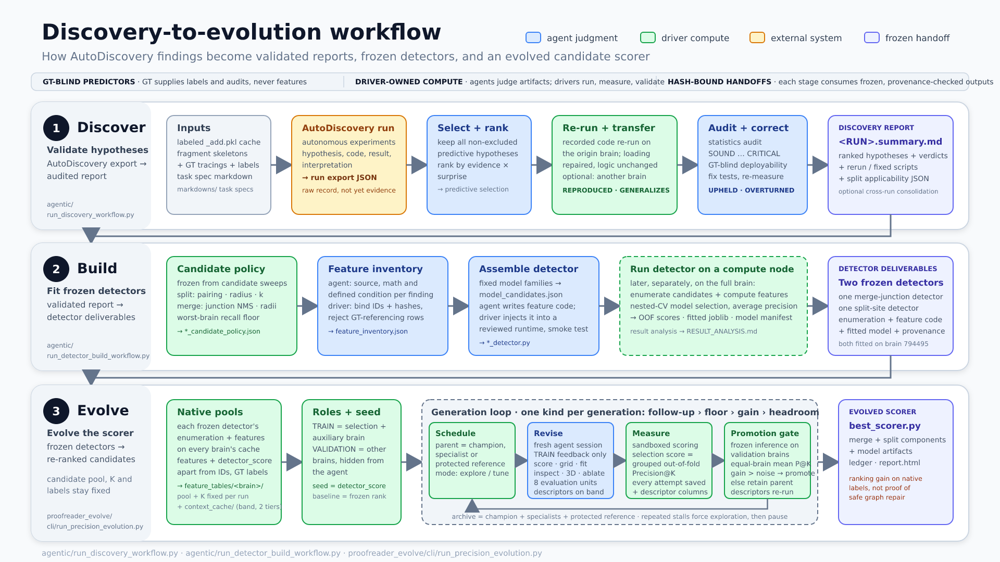

# exa-spim-agent

Agentic discovery-to-evolution workflow for ExaSPIM neuron proofreading. Starting
from labeled skeleton caches, the repository

1. turns AutoDiscovery experiment exports into reproduced, audited discovery reports,
2. compiles the surviving findings into frozen split- and merge-error detectors, and
3. evolves a scorer that re-ranks each detector's own candidates behind a
   held-out promotion gate.



## Workflow at a glance

| Stage | Driver | Consumes | Produces |
|---|---|---|---|
| 1. Discover | `agentic/run_discovery_workflow.py`, `agentic/run_consolidation_workflow.py` | one AutoDiscovery run export `autodiscovery/<RUN>.json` plus the origin `_add.pkl` cache | `autodiscovery/<RUN>.summary.md` with per-hypothesis verdicts, `<RUN>.json.predictive.verdicts.json`, re-runnable hypothesis scripts, a split feature-applicability manifest |
| 2. Build | `agentic/run_detector_build_workflow.py`, `agentic/detector_build/` | the finished report and its scripts, the declared candidate rule (`proofreader_evolve/candidate_pools.json`, `candidate_rules.py`) | `autodiscovery-application/<RUN>/`: frozen candidate policy, feature inventory, model configuration and detector script; after a compute-node run, out-of-fold scores, a fitted model and its provenance |
| 3. Evolve | `proofreader_evolve/` | one frozen merge-junction detector, one frozen split-site detector, labeled caches for every brain | `proofreader_evolve/runs/precision_*/best_scorer.py` with ledger, traces and `report.html` |

Three rules hold in every stage:

- **GT-blind predictors.** Ground truth supplies labels, audits and evaluation; it
  never enters a feature, a candidate rule or a scorer.
- **Driver-owned compute.** Agents read artifacts on disk and write judgments,
  code or prose; the drivers run every long computation and check what the
  agents produced.
- **Hash-bound handoffs.** Each stage consumes the previous stage's outputs by
  exact path and SHA-256; stale or mismatched inputs fail instead of being
  substituted silently.

## Quick start

Every command runs in the `panda` conda environment; steps that load a dataset
cache need a compute node with more than 20 GB of RAM, and agent steps need
`ANTHROPIC_API_KEY` (see [docs/prerequisites.md](docs/prerequisites.md)).

```bash
conda activate panda

# Stage 1: validate one AutoDiscovery run (optional transfer test on another brain)
python agentic/run_discovery_workflow.py autodiscovery/<RUN>.json \
    --pkl cache/dataset_cache_<brain>_mcl<N>_add.pkl --direction predictive \
    --extra-pkl cache/dataset_cache_<other-brain>_mcl<N>_add.pkl \
    --companion markdowns/rerank_companion_<brain>_<kind>.npz

# Stage 2: compile the report into a frozen detector, then run it on a compute node
python agentic/run_detector_build_workflow.py autodiscovery/<RUN>.json
python autodiscovery-application/<RUN>/merge_junction_detector.py cache/dataset_cache_<brain>_mcl<N>_add.pkl

# Stage 3: evolve the scorer on the detectors' own candidate pools
python -m proofreader_evolve.cli.run_evolution \
    --train-brains 794495,802449 --selection-brains 802449 \
    --validation-brains 789202,794493,794491 --merge-k 300
```

## Documentation

| Document | Covers |
|---|---|
| [docs/prerequisites.md](docs/prerequisites.md) | the `panda` environment, compute-node jobs, credentials, the labeled `_add.pkl` caches |
| [docs/stage1_discovery.md](docs/stage1_discovery.md) | AutoDiscovery runs, the discovery workflow phases and artifacts, consolidation and ranking |
| [docs/stage2_detector_build.md](docs/stage2_detector_build.md) | candidate rules and sweeps, the detector build steps, running a detector, detectors in use |
| [docs/stage3_evolution.md](docs/stage3_evolution.md) | table preparation, the evolution run, scorer contract and promotion gate, the reviser session, exploration tools, archive and scheduling, run artifacts and reports |
| [docs/labeled_caches.md](docs/labeled_caches.md) | building and verifying the labeled caches, checking that a brain's fragments and segmentation are one run, comparing brains and MCLs |
| [docs/gt_merge_site_tools.md](docs/gt_merge_site_tools.md) | inspecting cached GT merge sites against detector positives |
| [docs/dataset_artifact_dependencies.md](docs/dataset_artifact_dependencies.md) | what to rebuild, in which order, after a cache changes |
| [markdowns/README.md](markdowns/README.md) | the task specifications given to AutoDiscovery and the cache schema |
| [proofreader_evolve/WORKFLOW_REVISION.md](proofreader_evolve/WORKFLOW_REVISION.md) | the maintained design record of Stage 3, with literature provenance |

Per-stage figures: [`agentic/discovery_workflow_diagram.png`](agentic/discovery_workflow_diagram.png),
[`agentic/detector_build_workflow_diagram.png`](agentic/detector_build_workflow_diagram.png),
[`agentic/split_merge_detection_pipeline.png`](agentic/split_merge_detection_pipeline.png),
[`proofreader_evolve/workflow_diagram.png`](proofreader_evolve/workflow_diagram.png),
[`proofreader_evolve/workflow_overview.png`](proofreader_evolve/workflow_overview.png) and
[`proofreader_evolve/data_overview.png`](proofreader_evolve/data_overview.png).

## Repository layout

```text
exa-spim-agent/
├── agentic/                    # Stage 1 and 2 drivers, helpers, figures, tests
│   ├── detector_build/         # inventory, model policy, assembly and verification modules
│   └── plans/                  # design records of the discovery workflow
├── autodiscovery/              # AutoDiscovery exports (*.json) plus generated reports and scripts
├── autodiscovery-application/  # Stage 2 deliverables, one folder per originating run
├── proofreader_evolve/         # Stage 3: cli/, harness/, artifacts/, plotting/, tests/, feature_tables/,
│                               #          descriptor_bank/, runs/, TODO.md
├── markdowns/                  # task specifications and the cache schema for agents
├── cache/                      # dataset_cache_<brain>_mcl<N>[_add].pkl (gitignored, large)
├── notebooks/                  # cache building, verification, candidate-pool sweeps
├── labeled_cache/              # python -m labeled_cache: build and relabel the _add.pkl caches
├── scripts/                    # one-off tools; diagrams/ renders the figures
├── docs/                       # the documents listed above, feature-scope contracts, literature notes
├── metrics_out/                # official reference metrics per brain
├── figs/                       # generated figures
├── .claude/agents/             # subagent definitions used by the drivers
└── configs/                    # credentials (gitignored) and image-alignment receipts
```

## Main outputs

```text
autodiscovery/<RUN>.summary.md                validated discovery report (Stage 1)
autodiscovery-application/<RUN>/              frozen detector deliverables and runs (Stage 2)
proofreader_evolve/feature_tables/<brain>/    detector-native candidate tables (Stage 3 input)
proofreader_evolve/runs/precision_*/          evolution runs: best_scorer.py, ledger, report.html
cache/                                        base and labeled pickle files
metrics_out/                                  official reference metrics
notebooks/verify_stats/                       cache-versus-reference comparisons
```

## Tests

```bash
conda activate panda
python -m unittest discover -s agentic/tests
python -m unittest discover -s proofreader_evolve/tests -t .
```

Both suites use small fixtures: no brain cache is loaded and no API is called.
