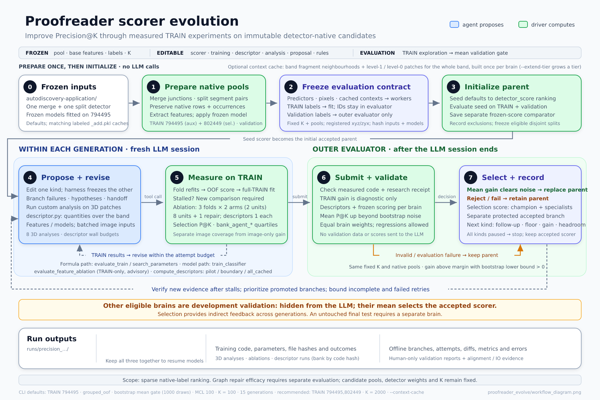
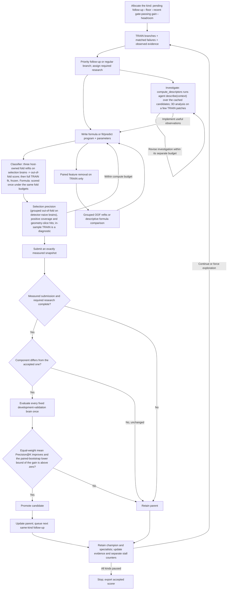

# Fixed-pool scorer evolution

`proofreader_evolve` has one workflow: improve Precision@K over GT-labeled rows
(three-valued labels, since 2026-10-09) on the
exact candidate pools of selected frozen AutoDiscovery detectors. It does not
edit graphs, expand candidates, retrain detectors or deploy scorers automatically.

## Pipeline



A one-page visual overview (frozen inputs, the generation loop, outputs and the
blindness boundary) is in [workflow_overview.png](workflow_overview.png); the data
model the search runs on (fixed candidate rows, growing columns, contexts attached to
the top band, labels held apart, the five paths from contexts to a score, and who sees
labels) is in [data_overview.png](data_overview.png).



1. Select one frozen merge-junction detector and one split-site detector from
   `autodiscovery-application/`, with their matching fitted joblibs.
2. Prepare tables from matching `cache/dataset_cache_<brain>_mcl<N>_add.pkl`
   caches. Call each detector's original universe builder and feature extractor;
   preserve candidate identity and split occurrences without extra enumeration caps.
   Enable only the native analysis groups owning columns in that fitted model's
   `feature_order` (including definedness columns). Shared groups remain intact;
   unknown or ambiguous feature ownership fails instead of enabling all groups.
3. Store predictor features plus `detector_score` separately from candidate
   identities and evaluator labels. Validate table, source and model provenance.
4. Evaluate the seed scorer and retain a separate frozen-detector baseline.
5. In each generation, choose a retained TRAIN branch and an `explore` or `tune`
   mode. A fresh LLM session edits one kind's `scorer.py`, `training.py`, `rules.md`,
   and `proposal.json`, plus `analysis.py` and `analysis_request.json` for direct
   TRAIN 3D investigation; the other kind stays at its accepted version. The kind
   is chosen per generation by the adaptive allocator (pending follow-up, a floor
   of one revision per `--kind-floor-every` generations, recent gate-passing gain,
   then remaining headroom; `--kind-schedule alternate` restores strict rotation)
   unless `--target-kind` is specified. Stratified TRAIN diagnostics
   and memory guide formula design. A literal numeric `PARAMS` dictionary separates
   constants from the formula. `evaluate_train({})` measures one candidate;
   `search_parameters({})` measures the proposed grid and restores its best
   successful candidate by the official selection score (grouped out-of-fold
   precision on the selection brains under `grouped_oof`; see the v13 section
   below). With `--context-cache`, `compute_descriptors` runs agent-written
   `describe(context)` over the cached candidate band and registers `bank_agent_*`
   predictors (v14 section below). Tune mode enforces an unchanged formula AST. The default budget is 8 evaluation units,
   shared by new configurations and optional feature-diagnostic fold fits,
   plus one repair after the first execution error. Proposal-format errors and
   cache hits spend no scoring budget (but still use SDK turns).
   Every attempt saves code, proposal, parameters, metrics, Top-K changes and
   counterexamples. `restore_candidate` recovers measured code by short ID;
   the final submission must exactly match a successful measurement.
6. Once required research/follow-up work is complete, evaluate the final measured
   candidate on every selected development-validation
   brain; a candidate byte-identical to the accepted combined scorer skips this step
   and the generation ends as `unchanged` (2026-10-12). Average merge/split Precision@K within each brain, then average the
   brains equally. Promote only if this mean exceeds the accepted parent's mean
   by more than `--precision-margin` and, in the default `--promotion-gate bootstrap`
   mode, the lower bound of the paired row-resampling interval of that gain is
   above zero (`--bootstrap-draws`, `--bootstrap-alpha`). Individual brain/kind
   regressions and TRAIN regressions are allowed. Reject invalid, nondeterministic or timed-out scorers;
   a failure on any selected brain rejects the candidate, not that brain.
7. Independently retain up to 5 TRAIN branches per kind. Keep the overall TRAIN
   champion first. Prefer specialists that lead fixed geometry slices or recover
   positive candidates missed by already retained branches, even if their mean
   precision is more than 0.02 below the champion. Fill remaining slots with
   near-best distinct Top-K alternatives, preferring different formula structures.
   Compare all successful trials in a generation together. A validation rejection
   does not remove an exploratory branch. Separately pin one reference per kind
   from the initial seed/current accepted component. It cannot be evicted by TRAIN
   selection and consumes no TRAIN archive slot. A new promoted component takes
   priority in the next same-kind generation, with at most one retry to produce
   fresh evidence from that workspace branch. Seeds and unchanged references do
   not enqueue this follow-up. Otherwise, every third scheduled generation
   per kind explores that reference, with independent merge/split counters.
   Cache-only and failed generations advance this cadence, not plateau measurements.
   Other rounds use the TRAIN champion/alternative scheduler; `--explore-every`
   counts newly measured non-reference rounds so specialist turns are not displaced.
   Two measured rounds without progress force exploration from an alternative
   branch when available. Progress means a new selection-score best (grouped
   out-of-fold precision under v13), a previously uncovered positive retained in
   the pool, or a new historical slice-hit best.
   Two unsuccessful forced explorations can pause that kind after a generation
   assigned to its current reference produces a new successful TRAIN measurement.
   Promotion replaces the reference and resets that kind's stagnation counters.
   All kinds paused ends the run. Cache-only rounds and failed measurements do
   not advance measured-progress counters or satisfy the reference requirement.
   Independently, two completed same-kind rounds without fresh measurements force
   an investigation. Performance plateaus also require a new measured comparison.
   Repeated observations and cached restores do not fulfill it; execution blocks
   are counted separately. Incomplete work skips validation and retains the policy.
   Default pauses also apply after two incomplete investigations or two consecutive
   execution-blocked rounds, with explicit reasons; these are not scientific rejection.

Feature-discovery rounds can additionally use matched failures, direct 3D analysis,
paired feature ablations and hypothesis-aware scheduling as described below.
Ablation evaluations share the scoring budget; geometry inspection, 3D analysis
and optional 2D previews each have separate allowances. Exploration tools do not
change the outer promotion gate.

The exploration parent and the accepted parent are distinct roles. TRAIN archive
selection reads TRAIN only; the reference identity comes from the host's promotion
decision and therefore carries indirect development-validation feedback. Only
TRAIN measurements and diagnostics are exposed in pool/plan files; no heldout
data, scores or decision reasons enter them. The promotion gate compares against the
accepted parent's full-precision measurements. TRAIN feedback's `parent_train` and
`parent_selection` also refer to that accepted parent, while its examples,
`ranking_delta` and `failure_cases.json` describe the exploration branch (v17);
`search_plan.json` identifies the branch.

### Raw-candidate ablation `--detector-prior raw` (2026-10-27)

**Question.** How much of the final validation precision comes from the whole AutoDiscovery
plus detector pipeline? `no-score` (2026-10-12) withholds only the fitted ranking and keeps the
293 `h*` feature columns that the AutoDiscovery runs discovered and the detector build computed
(the 802449 merge table holds 294 columns: 293 `h*` plus `detector_score`; the label-blind
candidate attributes are not in the frame at all). `raw` withholds the `h*` columns too. Plan and
decisions: `plans/raw_prior_ablation.md`.

**What the agent gets per arm.**

| | frozen | no-score | raw |
|---|---|---|---|
| `detector_score` | predictor and seed | no | no |
| 293 `h*` columns | yes | yes | no |
| raw candidate columns | implicit in `h*` | implicit in `h*` | the only base columns |
| seed | `artifacts/scorer.py` | `artifacts/scorer_no_score.py` (constant) | the same constant |
| `bank_context_available` / `row_in_band` | yes | no | no |
| descriptor scopes | pilot, boundary, all_cached | all_cached | all_cached |
| descriptor bank | `descriptor_bank/` | `descriptor_bank_no_score/` | `descriptor_bank_raw/` |

**Mechanism.** `detector_prior.strip_to_raw` replaces every loaded table's frame (TRAIN and
validation alike, in memory; files and digests untouched) by `raw_columns(kind, candidates)`,
built from the label-blind rows of `candidate_rules.GEOMETRY_FIELDS` / `OCCURRENCE_FIELDS`:
merge `raw_degree`, `raw_candidate_family` (junction 0 / tip_to_shaft 1), `raw_tip_gap_um` (NaN
on junction rows); split `raw_gap_um`, `raw_partner_rank`, `raw_anchor_side` (a 0 / b 1),
`raw_node_role_a/b` (tip 1 / non_tip 0), `raw_occurrence_count`, `raw_occurrence_gap_min_um`,
`raw_occurrence_gap_max_um`. Coordinates and identifiers are never exposed. The score and the
dropped frame stay on the table as host-only copies. Descriptor contexts carry the raw columns
(`context_cache.contexts` adds `raw_*` columns to the manifest's base columns);
`check_source` refuses `h<digits>_` names as well as the hidden names for the seed and for
restored descriptor programs; the contract appends `NOTICE_RAW`; each mode has its own
descriptor bank and refuses the other modes' banks. Everything `no-score` withholds stays
withheld (band hidden, `all_cached` only, every GT-labeled row must be cached).

**Baselines.** Before the strip the host measures the frozen detector (as `no-score`); after
it, two raw heuristics on the raw columns (`raw_heuristic_source`: split by the smallest gap,
merge by junction arity with the tip gap as tie-breaker), recorded under
`baseline.json["raw_heuristics"]` as paper references, never the seed and never shown to the
agent. The seed is the constant scorer, so its Precision@K is near the labeled base rate.

**Comparison.** Identical pools, K rule, partition, aggregation, gate and budgets in the three
arms; raw runs pass `--descriptor-generation-wall-seconds 7200`. Starting points differ a lot
(frozen split seed about 0.85, raw split seed near 0.41 on 802449), so the arms are compared on
final values, not per-generation gains: raw to no-score is the discovered features'
contribution, no-score to frozen the fitted detector's, frozen to the evolved scorer
evolution's. Runs are sequential, one setup per run (frozen, then no-score, then raw), each
preceded by its `--generations 0` seed baseline. Neither ablation has completed a real run.
Not in scope: the pool definition (benchmark), table or cache rebuilds, a cache-free arm, the
preflight (it does not know the mode).

### Uniform K = GT positives (2026-10-27, objective v5)

**Motivation.** The first two v4 runs, `precision_20261026_210812_yqeacq5s` (n280, 13
generations) and `precision_20261027_000457_5d0_pbkb` (n242, 14 generations; both stopped on
2026-10-27), each accepted two merge generations early (0.4714 to 0.4948 and 0.4714 to 0.4909)
and then rejected every later candidate: point deltas between -0.004 and +0.005 against
bootstrap lower bounds of -0.001 to -0.009, and six split generations whose selection gain
(0.846 to 0.861-0.866 on 802449) reversed on four of the five validation brains. The merge
cap of 300 bound on exactly one pool, the selection brain 802449 (1,038 merge positives among
27,934 labeled rows), so the agent's selection score was Precision@300, the head of the
ranking at recall 0.13, while the validation merge pools (41 to 144 positives) were scored at
K = 2 x positives, a depth where recall was 0.24 to 0.40. Re-ranking every measured
candidate's stored `selection_state.npz` (`notebooks/k_rule_check/selection_k_variants.py`)
shows the mismatch directly: over the 20 validated merge candidates of both runs, the Spearman
correlation between the submitted candidate's selection score and its validation merge mean
was 0.67 at K = 300, 0.88 at K = positives, 0.85 at 1.5 x, 0.75 at 2 x and 0.73 at 3 x
(per run 0.63 / 0.76 / 0.80 / 0.78 / 0.75 and 0.43 / 0.70 / 0.73 / 0.55 / 0.55). Within one
generation the attempts' Precision@300 spread over 0.35 to 0.45 while one hit is 0.0033 and
the binomial standard deviation at 134 hits of 300 is 0.029, so the agent treated 0.447
against 0.46 as a result. The validation side of the same check
(`notebooks/k_rule_check/validation_k_variants.py`, merge tables of the five validation brains
re-scored from the runs' model artifacts) is recorded in the evidence log row below.

**Rule.** Defaults are now uniform: no cap for either kind and ratio 1.0 for both
(`--merge-k none`, `--k-positive-ratio 1`), so every pool in TRAIN, selection and validation
ranks exactly its GT positives and Precision@K equals Recall@K (R-precision) for merge as it
already did for split. The selection brain is scored at the same operating point as the
validation brains (802449 merge K = 1,038; validation merge K = 74 / 41 / 125 / 144 / 140),
the attainable ceiling is 1 for both kinds (merge headroom in `kind_schedule` was capped at
0.5 under ratio 2), and `--merge-k 300 --k-positive-ratio merge=2,split=1` restores v4.
`Budgets` itself is unchanged. Versions: `SCORING_VERSION`, both gate versions,
`BOOTSTRAP_VERSION` and `PROTOCOL_VERSION` are `*-v5-uniform-k`; `run_records` reads v1 to
v5 (`PRECISION_V4` added). Agent-facing `budgets` is the largest TRAIN pool K per kind
(merge 1,038 from 802449, split 6,535), as it already was for the capless split.

**Whole-brain holdout selection brains (same day).** `grouped_folds` / `SelectionProtocol`
take `holdout_brains` (`--selection-holdout-brains`, a subset of the selection brains,
grouped_oof only): every row of such a brain forms one group assigned to a single fold
(round-robin over the three folds in brain order, outside the load balance of the grouped
brains), so its out-of-fold scores come from a model that never saw the brain, while the
brain joins the fitting rows of the other two folds. The fold count and cost are unchanged.
The selection report lists `holdout_cells` and `holdout_precision` (hits / K pooled over the
counted holdout cells of the kind), which reach the agent through the TRAIN feedback as the
cross-brain transfer signal; fold details carry the role `selection_holdout` and the
partition identity includes it. Motivation: the within-brain grouped folds of 802449 could
not see cross-brain shift (both v4 runs' split re-rankers gained 0.015 to 0.020 on 802449 and
lost on four of five validation brains), and the rebuild finished the same day with four
detector-naive brains (747807, 754610, 754612, 754613) whose GT positives are 125 / 19 / 22 / 9
merge and 1,509 / 1,707 / 1,245 / 1,048 split. Holding 802449 out whole was rejected: it
holds 55% of all merge positives across the eleven brains (1,038 of 1,883), so a model fitted
without it (321 merge positives) is not the model that ships.

**Positive-weighted aggregation (same day).** `Budgets` carries `aggregation`
(`--aggregation positive-weighted`, the new default; `equal-brain` is the rule of every
earlier run): within each kind the counted pools are pooled by GT positives (hits summed over
pools / K summed over pools, the pooled recall at K = positives), then the kinds are
averaged. It applies to `aggregate_precision` (selection, TRAIN and validation reports, which
record the rule in `aggregation`), `acceptance` (which refuses reports with different rules),
`paired_bootstrap` (the per-draw kind delta is pooled the same way) and
`kind_schedule.headroom`. Motivation: under the equal-brain mean 794493's 41 merge positives
weighed as much as 750318's 144, one hit on 794493 moved its cell by 0.024, and in the
selection set a 22-positive holdout cell would have had the weight of 802449's 1,038.

**Partition (2026-10-27).** TRAIN 794495 (auxiliary, detector-fitted), 802449 (grouped
folds), 747807, 754610, 754612, 754613 (whole-brain holdouts); validation unchanged (789202,
794493, 794491, 750318, 751473). Fitting positives: merge 1,359, split 14,541; selection
positives: merge 1,038 + 125 + 22 (754610 and 754613 below the 20 floor), split 12,044;
validation merge 524, split 12,581.

**What follows.** Numbers are not comparable with v4: merge precision roughly doubles at
K = positives, the split half is unchanged, the positive-weighted mean reweights the brains,
and the next run's seed is the v5 reference. Merge remains data-limited outside 802449 (the
four new brains add 175 merge positives, three of them below or at the floor), so the merge
cross-brain cells are a transfer check rather than a second selection signal. The validation
merge pools remain small (524 labeled slots at K = positives), so the gate's resolving power
is unchanged by these rules; making 794495 a selection cell through the detector's own
out-of-fold probabilities (kept per candidate in the detector run CSVs) is a candidate
follow-up, as is an untouched final test brain.

### Repeated submissions and earlier-generation access (2026-10-26)

**Motivation (run `precision_20261025_193120_5to8nx13`, 20 generations).** Nine generations
re-measured a candidate the outer evaluator had already seen. Generations 8 and 10 submitted
cached repeats (same bytes) of the candidates validated in generations 4 and 9; generations 13,
14 and 18 restored the accepted split component (caught as `unchanged`); generation 15 submitted
a rewritten merge program whose scores were identical to generation 11's on every TRAIN and
selection cell; generations 16 and 19 submitted cached repeats of the same champion, which the
agent had included as the control arm of a tuning grid and which tied for best on the
selection score. Each repeat returned the validation hits already on record (17 / 4 / 44 for
the champion, four times). Two causes: the host compared a submission only with the accepted
component and only by bytes, and nothing told the agent that its search parent had already
been validated and not promoted (`search_plan.search_parent` carried `status: evaluated` and the
selection score; the training tool reported `cached_from` but not the outer outcome). A third:
`tool_audit.jsonl` holds six denied reads of earlier generations' `training.py` /
`descriptor.py`, after which the agent rebuilt the same program from the hypothesis memory's
prose. Plan: `plans/repeated_submissions.md`.

**Changes.**
- **Identity.** Every measured entry carries `scores_sha256` next to `component_sha256`:
  `candidate_pool.scores_digest` hashes the kind's exact score vectors over the TRAIN
  in-sample state and the selection state (`('train', state)`, `('selection', state)`), so a
  program that reproduces a measured ranking with other bytes is the same candidate. Top-K
  membership (`top_k_sha256`) is not an identity: a scaled variant with the same ranking stays a
  fresh measurement (the promotion follow-up in `test_kind_schedule` relies on that).
- **Repeat detection.** `CandidatePool.validated[kind]` records every outer measurement
  (`mark_validated`: generation, experiment, both digests, promoted; the accepted component is
  registered at generation 0 and every validated submission after its gate decision, ledger
  `submission_validated`). After the `unchanged` check the driver asks
  `pool.validation_of(kind, entry)`; a match by component or by scores ends the generation at
  stage `repeated_submission`: no descriptor inference on validation brains, no validation
  evaluation, ledger `submission_repeat = {generation, experiment, promoted, by}`,
  `validation_gate.skipped = "repeated_submission"`, reason `VALIDATION: Repeated submission:
  ... has the same component | <kind> scores as ... (validated in generation N, promoted | not
  promoted)`, trajectory event `repeated_submission`, decision line `repeated`, report status
  `repeated` (`evolution_report.generation_status`), handoff host status `repeated_submission`.
  Stall accounting is unchanged: fresh TRAIN attempts still count the round, and a repeated
  submission improves nothing, so `stalled_rounds` grows as it did for the duplicates.
- **What the agent sees (status only, never a validation number or the word).**
  `search_plan.search_parent.outer_measurement`, `complementary_candidates[].outer_measurement`
  and `candidate_pool.json` `candidates[].outer_measurement` are `{generation, experiment,
  promoted, by}` or null. A training-tool result for a candidate the outer evaluator already
  measured (cached repeat or a fresh measurement with identical scores) carries
  `outer_measurement` with a note that submitting it again ends the generation as repeated
  (trajectory `outer_measurement_known`). `restore_candidate("best")`, which the submission
  fallback also uses, prefers the best measured candidate the outer evaluator has not seen and
  says so in a `note`; the agent's own explicit submission is never replaced. The generation
  prompt and `artifacts/scorer_rules.md` state the rule and that a tuning round's control arm is
  for comparison, not for submission. The existing guard that no agent-visible plan or pool file
  contains the word "validation" is kept (`test_kind_schedule`), hence the field name.
- **Earlier generations readable.** `earlier_generation_readables(run_dir, gen_dir)` adds, for
  every earlier `genNNN/` of the run, the TRAIN artefact trees `experiments/`,
  `classifier_fits/`, `descriptor_runs/` and the files `scorer.py`, `training.py`,
  `descriptor.py`, `analysis.py`, `rules.md`, `proposal.json`, `search_plan.json`,
  `hypothesis_memory.json`, `train_feedback.json`, `feature_statistics.json`,
  `failure_cases.json` to the reviser's read allowlist (`bind_session_options`
  `readable_paths` / `readable_dirs`; writes stay confined to the current generation).
  `evaluation.json`, `reviser_result.json`, `reviser_prompt.txt`, trajectories and
  `image_evidence.json` of other generations stay closed: they carry validation measurements.
- Not changed: the planner (`next_plan`) and its tuning / exploration cadence, the selection
  protocol, the promotion gate, and the `unchanged` path for a byte-identical accepted component.

**Expected effect.** On `5to8nx13` generations 8, 10, 15, 16 and 19 would have ended as
`repeated` (13, 14 and 18 remain `unchanged`), and in generations 15, 16 and 19 the agent would
have been told before submitting that the champion was already measured and not promoted. The
change creates no better candidates; it stops spending generations and validation evaluations
on known results. No evolution run under it yet.

### Split K = GT positives (2026-10-26, objective v4)

**Motivation.** Run `precision_20261025_193120_5to8nx13` (2026-10-25/26, 20 generations, the
first on the 2026-10 detectors and the rebuilt tables; final validation mean 0.5190 from a seed
of 0.4996) ended with the validation split cells at Precision@1000 of 0.982 / 0.929 / 0.917
(789202 / 794493 / 794491) against a seed of 0.965 / 0.918 / 0.917, while those pools hold
2,783 / 1,759 / 1,820 GT positives (Recall@1000 0.35 to 0.53). Six of twenty generations went
to split: generations 4 and 8 produced the same validation ranking, generation 12 was accepted
(+17 / +11 / 0 hits) and generations 13, 14 and 18 were unchanged resubmissions. The frozen
split detector's own labeled ranking (`notebooks/split_rank_curves.py`, n13, 2026-10-26) shows
where the remaining errors are: precision by labeled rank band on 794491 is 0.917 (ranks 1 to
1000), 0.790 (1000 to 1500), 0.558 (1500 to 2000) and 0.288 (2000 to 2500); at K = positives the
detector scores 0.881 / 0.847 / 0.830 on the validation pools and 0.859 / 0.847 on 794495 /
802449, with recall at precision >= 0.9 of 0.84 / 0.60 / 0.62. A fixed cap of 1000 measured a
window the detector had already solved and hid the band where ranking still matters.

**Rule.** `Budgets` takes a per-kind positive ratio and allows a kind without a cap:
`K = ceil(positive_ratio[kind] x GT positives)`, limited to the cap when the kind has one; a zero
ratio keeps the cap (fixed K), so a capless kind needs a positive ratio. Defaults: merge
unchanged (ratio 2.0, cap 300); split ratio 1.0 with no cap (`--split-k none`), so every split
pool ranks exactly its GT positives and Precision@K equals Recall@K there (R-precision; Manning,
Raghavan and Schütze, *Introduction to Information Retrieval*, 2008, section 8.4).
`--k-positive-ratio` accepts one number for every kind or `merge=R,split=R`; `--merge-k` /
`--split-k` accept an integer or `none`. K = 2 x positives was rejected for split because on
789202 it exceeds the labeled rows (5,566 > 4,975) and the metric collapses to the labeled base
rate of 0.559; K = 1.5 x positives would cap that pool at 0.667. Recall at a precision floor was
considered and kept as a diagnostic idea only: the top of the curve is flat, so the crossing
depth jumps (794493: recall 0.08 at precision >= 0.95 versus 0.60 at >= 0.90).

**What follows.** Agent-facing `budgets` stays one integer per kind: the cap, or for a capless
kind the largest K resolved on a TRAIN pool (`Budgets.kind_budget` / `kind_budgets`), which
`plan_image_scoring` and the feedback reading guide use for the image `selection_k`.
`kind_schedule.mean_k` falls back to the uncounted cells' mean K (infinity with no cells) for a
capless kind, and the fixed-K crowding warning applies per kind with a zero ratio. Versions:
`SCORING_VERSION`, both gate versions, `BOOTSTRAP_VERSION` and `PROTOCOL_VERSION` are
`*-v4-per-kind-k`; `run_records` reads v1 to v4 (`PRECISION_V3` added). Numbers are not
comparable with v3 runs: the split half of the mean falls from about 0.93 to about 0.85 at the
seed, and the next run's seed is the v4 reference. Not changed: unlabeled rows are still never
ranked, and the detector places 3,275 / 39,965 / 92,064 unlabeled rows above the 1000th labeled
row on the three validation pools (same script); a one-sided availability rule for split (one
segment on a GT neuron, the other on none, label 0) is a candidate for extending the labels and
is not implemented.

### Detector-prior ablation `--detector-prior no-score` (2026-10-12)

**Question.** How much of the final development-validation Precision@K comes from the
frozen detector model? Every run so far started from `detector_score` and kept it as a
predictor, so the evolved gains cannot be separated from the frozen ranking. Plan:
[plans/no_detector_score_ablation.md](plans/no_detector_score_ablation.md).

**Rule.** `--detector-prior no-score` keeps the detector-native pools, the detector's
feature columns (computed quantities, not fitted), labels, K, brain roles, budgets and the
promotion gate, and withholds the frozen ranking from everything the reviser, its
scorers, training programs and descriptors see. Replacing only the seed (`--start-from`)
is not this ablation: the column would stay available and the contract invites its use.
The frozen score reached the agent through more than the column:

| Path | Treatment |
|---|---|
| `detector_score` in `table.features` | Dropped in memory after the host measures the frozen baseline (`detector_prior.strip`; table files, digests and `native_pool.py` unchanged); a host-only copy stays on `table.host_detector_score` |
| `bank_context_available` (1 inside the detector band) | Not registered |
| `row_in_band` in descriptor contexts | Omitted (`ContextCache(expose_band=False)`) |
| Descriptor scopes `pilot` / `boundary` (detector-rank windows) | Refused; `all_cached` only (`DescriptorRuns.allowed_scopes`) |
| Descriptor coverage = band without a labeled extension | `--context-cache` requires every entry to cache all GT-labeled rows, else the run stops before any LLM call |
| Local / image `selection_feature` default `detector_score` | Fails with a message to name another base column |
| Preflight all-missing row sets `detector_score=0` | Only when the column exists |
| Descriptor bank values computed with the score | Separate default bank `descriptor_bank_no_score/`; the frozen default bank is refused |
| Contract and guides mention the score | `detector_prior.NOTICE` appended to the system prompt and seed rules |
| Starting scorer / restored descriptors | Default seed `artifacts/scorer_no_score.py` (constant); sources naming a withheld column, and restored descriptors from a detector-rank scope, are refused |

The constant seed ranks GT-labeled rows by candidate identity, a label-independent
order. The frozen baseline is still measured (first, on the unstripped tables) and
reported as the host-only comparator; `manifest.json` (`detector_prior`),
`dataset_split.json` and the report header record the mode. `frozen` (default) is
unchanged.

**Interpretation.** Compare absolute final validation Precision@K and the per-generation
trajectory against a reference run with the same brains, K and budgets; promotion counts
are not comparable (early promotions over a constant seed are easy). 794495 stays in TRAIN
so the only difference is the prior. Project-specific design; no literature source.

### Labeled extension of the context cache (2026-10-12)

**Motivation (TODO.md "Context cache misses many GT-labeled rows", measured 2026-10-11).**
The context cache holds the top 50,000 detector-ranked rows per brain and kind; rows outside
that band have NaN in every `bank_agent_*` column. Precision@K, however, ranks GT-labeled
rows only, and many of them lie outside the band: 55% of the labeled split rows (34% of the
positives) on the selection brain 802449, 71% of the labeled split rows on 794491, 37% of the
labeled merge rows on 802449. Agent descriptors therefore could not act on exactly the rows
where re-ranking has the most to gain (low detector rank, positive by GT), and the selection
brain measured descriptor gains on a subset of its labeled rows.

**Rule.** `precompute_context_cache --labeled-extension` appends, after the band, the
GT-labeled rows outside it (`segment_on_gt`, the widest availability definition of both
kinds, so the cached rows do not depend on the definition a run selects; sidecars required).
The band block stays first in detector-rank order, the extension follows in ascending row
order. `pilot` and `boundary` scopes read the band block only; `all_cached` reads both.
`bank_context_available` is 1 on band rows only and remains a function of detector rank;
`row_in_band` in the worker context is False on extension rows. Rows the metric ranks all
have a context; unlabeled rows outside the band stay NaN. Nothing about labels enters the
cache: the extension records which rows are GT-labeled (`extension.source`, counts, row
digest), not their labels, and the contexts are the same label-free inputs. A scorer cannot
gain Precision@K from descriptor missingness because every ranked row now has values.

**Implementation.** `ContextCacheBuilder._grow(table, provider, image_reader, rows, tiers,
...)` replaces an entry's row list in place: every full chunk inside the common prefix of the
old and new row lists is kept byte-for-byte (geometry and each image tier), the first chunk
after the prefix is rebuilt, the rest appended, directories swapped atomically, then
`rows.npy`, then the manifest (`extended.common_prefix`, `extended.reason`). `extend_band`
is now a thin caller: it keeps extension rows the larger band does not absorb, so a band
growth after the extension re-reads the extension rows (a few thousand) and nothing else.
`extend_labeled(table, provider, image_reader, labeled_rows, source=...)` is the second
caller; repeating it with the same rows only refreshes the manifest record. Manifest fields:
`band_rows` (unchanged meaning), `extension_rows`, `extension` (`source`, `labeled_rows`,
`rows`, `rows_sha256`). `ContextEntry.band`, `band_rows`, `extension_rows`; `summary()`
adds `extension_rows` / `extension_definition` (shown in `model_environment.json`);
`preflight` reports `extension_rows`. `ContextCache.identity_key` adds the extension row
digest only when an extension exists, so entries without one keep their digest and their
descriptor-bank results; extended entries recompute bank results once (the `all_cached` rows
changed anyway). Cache version unchanged (`candidate-context-cache-v1`; new fields are
optional, old entries read as `extension_rows` 0).

**Cost.** Only the extension rows are read: about 7,000 each for 802449 merge and split,
900 to 2,600 for the other measured cells, the six older-microscope brains not yet
measured (their split pools reach 1.9M rows). At the measured rate (about 18 min per 24k
rows per tier with 16 readers) each cell costs minutes, the eleven brains one to a few hours
serially. Frozen inference (`all_cached`) grows by the same rows, about 15% per brain.

**Build and verification.** One launcher call, one brain per subprocess:

```bash
python -u -m proofreader_evolve.cli.precompute_context_cache --brains 794495 802449 789202 794493 794491 \
  --mcl 100 --readers 16 --band-rows 50000 --labeled-extension
# then 747807 750318 751473 754610 754612 754613 the same way; preflight then shows extension_rows per cell
```

Built 2026-10-13 by the user on n268 (`log/context_cache_labeled_extension_20261012.log`): 22 cells in
8,291 s, 18 entries extended by 40 to 11,649 rows (802449 merge: 11,649, because `segment_on_gt` labels
29,200 merge rows there; 794495 was rebuilt from the current GT the same evening, extensions 52 merge / 1,428 split), the four whole-pool entries unchanged, common prefix = band everywhere, 0 new
image failures, cache 117 GB. Verified the same day (see the evidence log): every GT-labeled row of every
cell is cached, sampled contexts load at both tiers with the right `row_in_band`, preflight reports
`extension_rows` per cell, and two registered descriptors recomputed on 802449 are byte-identical to the
band-only results on all 50,000 band rows. Split numbers after the extension are not comparable with
earlier runs (descriptors reach rows they never saw), so the seed baseline of the next run is the
reference.

### Split cap raised to 1000 (2026-10-12)

**Motivation (run `precision_20261011_235340_phg8xri5`, final state).** With `--split-k 500`
the accepted split scorer saturated the ranked window on every brain. On the selection brain
802449 the champion's out-of-fold Precision@500 was 0.980 and the generation-20 candidate's
0.978 (490 and 489 hits of 500), yet the candidate was accepted on the validation brains
(+30 hits over seven of nine pools); generation 13 passed selection and lost on the
validation brains. The nine validation split pools scored 0.916 to 0.984 at K = 500 while
recalling 10 to 46% of their GT positives. A window that is already 98% positive on the
selection brain separates split candidates by a handful of hits, so selection carried little
signal in the second half of the run.

**Change.** The `--split-k` default is 1000 (500 from 2026-10-09, 100 before). Nothing else
changes: under objective v3 every pool still ranks `K = min(cap, ceil(2 x GT positives))`,
and the merge cap stays 300. Every split pool of the eleven brains in use has at least 1,020 GT
positives (754613; 802449 has 6,393), so each ranks exactly 1,000 rows and the attainable
ceiling stays 1.0. The frozen-baseline sweep in `TODO.md` measured lower Precision@1000 than
Precision@500 for the seed (0.86 / 0.74 / 0.71 / 0.89 against 0.88 / 0.81 / 0.76 / 0.89 on
789202 / 794493 / 794491 / 802449); that drop is the headroom the evolved scorer is now
measured on, and the per-pool standard error of a 1,000-row window is smaller. Split numbers
at K = 1000 are not comparable with the K = 500 runs; the next run's seed baseline is the
reference. Runs that want the old window pass `--split-k 500` explicitly.

### Unchanged submissions and descriptor chunk loading (2026-10-12)

**Motivation (run `precision_20261011_235340_phg8xri5`, 20 generations, v2 objective).**
Two generations (14 and 18) ended with the agent restoring the accepted reference and
submitting it byte-for-byte unchanged (`candidate_restored ... no new evaluation`). The host
still ran frozen descriptor inference and the full validation evaluation (about six minutes
each, both already cached) and rejected them as "No sufficient mean Precision@K gain:
0.508852 -> 0.508852", so the ledger, report and hypothesis memory recorded them like any
other rejected candidate. Separately, every generation that submitted a new descriptor paid
about seven minutes per validation brain of frozen inference, serially over nine brains
(generation 16: 7982 s wall, generation 20: 5884 s). A measurement of one brain's inference
(747807 split, the generation-20 image descriptor `838d3ccb5ff9`, 42 batches of 256 rows,
14 sandboxed workers on n268) showed the host, not the workers, as the limit: 944.5
worker-seconds over 114.1 s wall is 8.3 effective workers out of 14; the host thread used
101.8 CPU-seconds, and 105 chunk loads served about 22 distinct chunks because
`ContextEntry._chunk` had no lock (up to four threads decompressed the same 50 MB level-0
chunk at once) and its window of eight chunks was smaller than the span of 14 in-flight
batches. The same path serves the agent's `compute_descriptors` on TRAIN.

**Changes.**
- **Unchanged submission.** After the research check, the driver compares the submitted
  component with the accepted component of the same kind (the other kind always comes from
  the accepted parent). If they are byte-identical it skips descriptor inference
  and the validation evaluation, records `submission_unchanged: true`, a `validation_gate`
  with `skipped: "unchanged_submission"` and equal parent/candidate means, the reason
  `VALIDATION: Unchanged submission: <experiment> is the accepted <kind> component ...`,
  trajectory event `unchanged_submission`, decision outcome `unchanged`, report status
  `unchanged` ("No change submitted (not evaluated)"), search-digest outcome `unchanged`
  (`plotting/plot_search_dynamics.py`) and handoff host status `unchanged_submission`. The parent is retained; `validation` stays `null`, so record readers
  that pair TRAIN with validation measurements skip the generation. A trained-model manifest
  pins its artifacts by digest, so byte equality of the component is equality of the model. A
  changed submission follows the previous path unchanged.
- **Chunk loading.** `ContextEntry._chunk` loads under a per-entry lock with a double check, keeps
  a window of `CHUNK_WINDOW = 12` decompressed chunks (14 workers x 256 rows span at most five
  1024-row chunks in two groups), counts `chunk_loads`, and `release()` clears the window;
  `DescriptorRuns.compute` releases the entry after every run and records `chunk_loads` in the
  run manifest. Before this, each of the 18 validation cache entries kept up to nine decompressed
  chunks (about 250 MB each for level 0) for the rest of the run.
- **Agent guide.** `scorer_rules.md` states that an unchanged reference submission ends the
  generation as `unchanged` with no outer evaluation.

**Measured effect** (same 42-batch slice, n268, 14 workers; before: 114.1 s wall, 101.8 host
CPU-seconds, 105 chunk loads, 8.3 effective workers; after, two repeats: 89.9 / 87.3 s wall,
51.7 / 56.8 host CPU-seconds, 22 chunk loads, 9.3 / 8.9 effective workers; worker-seconds
fell from 944.5 to 839.5 / 776.9 because the workers compete less for CPU). About 23 %
less wall time per brain and half the host CPU; the window is empty after `release()`.
The pool is still host-bound (about 9 of 14 workers in flight): the remaining host work per
batch is serialising 256 contexts and writing their patches (about 49 MB), which holds the
interpreter lock. Logs: `claude_scratch/ab_chunk_lock.out` (before) and `measure_locked.out`
(after) beside the repository, not committed.

**Not changed.** Brain-level parallelism of frozen inference was not added. Scaled to the
run, the fix takes the nine-brain inference of the generation-20 descriptor from about 67 to
about 52 minutes; running brains in separate interpreter processes (threads share the lock)
could at best use all 14 workers, about 40 minutes, because the descriptor itself costs about
3,600 worker-seconds per brain. That residual gain would require forking the multi-GB host
or reloading tables in a subprocess, so it is deferred. Reducing inference to the GT-labeled
rows that the metric uses is recorded in `TODO.md` as an open item (it changes pool-relative
formulas and ties row selection to GT availability). The promotion gate, selection protocol,
candidate pools and descriptor contract are unchanged.

### Per-pool Top-K from GT positives (2026-10-12, objective v3)

**Motivation (evidence from runs `precision_20261011_230334_62sb04xi` and
`precision_20261011_234710_sssj3jpw`, 10 generations each, identical settings).**
Both runs reached the same final mean (0.5039 / 0.5050 from the seed 0.4229), and the
third concurrent run (`precision_20261011_235340_phg8xri5`, 20 generations) sat at 0.509
after 16. At one fixed K = 300 the nine validation merge pools had hard ceilings
`min(positives, K) / K` of 0.030 to 0.293 and three of them (754610, 754612, 754613 with
9, 17 and 9 GT positives) were already at that ceiling, yet carried one third of the
merge weight. The merge mean could therefore not exceed about 0.17, and the late
generations of both runs were rejected with gains of one or two hits "within
resampling noise" (gen 7, 8, 9 of `sssj3jpw`; gen 10 of `62sb04xi`). The 2026-10-09
`label_availability_warning` already flagged 754613 (K above half of its 449 labeled
rows). TODO.md items "K for three-valued runs" and "Merge validation cells" asked for
K scaled to positives.

**Rule.** `--merge-k` / `--split-k` become per-kind caps. Every pool (brain x kind)
ranks its own `K = min(cap, ceil(--k-positive-ratio x GT positives in that pool))`
(default ratio 2.0; 0 restores one fixed K per kind), so every counted pool has the same
attainable ceiling `1 / ratio` when the ratio binds. Pools with fewer than
`--min-positives` GT positives (default 20) are still scored, traced and reported, with
`in_mean: false`, but are excluded from the promotion mean, the paired bootstrap and the
kind headroom used by the adaptive schedule. The mean is taken per kind over the counted
brains and then over kinds; with every pool counted this is algebraically the former
equal-brain mean of per-brain kind means, so fixed-K runs (`--k-positive-ratio 0
--min-positives 0`) reproduce the v2 numbers. Both inputs are label counts, so every K is
fixed for the run and the "fixed benchmark" identity check (`requested_k`, `effective_k`,
`positives`, now also `in_mean`) still applies between parent and candidate. With the
current tables: validation merge K becomes 162 / 152 / 172 / 124 / 176 / 58 on
747807 / 750318 / 751473 / 789202 / 794491 / 794493 (all ceiling 0.5), the three small
merge pools (K 18 / 34 / 18) are excluded, every split pool keeps the split cap (500 then,
1,000 since the same day's cap change; 1,020 to 6,393 positives), the selection brain
802449 merge keeps K = 300 (825 positives) and the
auxiliary TRAIN brain 794495 merge drops to 228 (114 positives; scored only under
`--selection-protocol in_sample`).

**Implementation.** `fixed_pool_scoring.Budgets` (a `Mapping`: `budgets[kind]` is the cap,
`k_for(kind, truth)`, `in_mean(truth)`, `describe()`, `resolve(banks)`; plain `{kind: K}`
dicts coerce to fixed-K budgets that count every pool). `rank_metrics` and
`selection_protocol.partitioned_rank_metrics` take the resolved K and an `in_mean` flag
and record it; `evaluate`, `paired_bootstrap`, `SelectionProtocol` (fold budgets and
`score_report`), `feature_ablation.measure_ablation`, `TrainingExperiments._k` (descriptor
plan/compute/cache keys, inference and the ablation identity's `k_rule`) and the driver's
`_restore_descriptors` resolve K per table; the research-evidence and ablation identities
record the `Budgets` description instead of one K per kind, and `plan_image_scoring` compares
the literal `selection_k` with the kind's K budget (reported as `k_budget`, formerly `scoring_k`). `aggregate_precision` returns
`per_kind_precision`, `per_brain_precision` (over counted cells), `excluded_cells` and
`macro_precision`; `paired_bootstrap` returns `excluded_cells` and averages kind-first over
counted cells. `kind_schedule.headroom` skips excluded cells and saturation uses the mean
resolved K of the counted cells (`kind_schedule.mean_k`). The driver emits `pool_budgets`
(every pool's positives, cap, K, membership) and `pool_budgets_excluded`, refuses to start
when every TRAIN or evaluation pool of a kind is below the floor, keeps the crowding
warning only in fixed-K mode, and records `budgets` (`caps`, `positive_ratio`,
`min_positives`, `k_rule`, `mean_rule`) and `pool_budgets` in `manifest.json`. Agent-facing
TRAIN feedback keeps `budgets` as the per-kind caps (the `selection_k` literal for image
scoring), adds `k_rule`, exposes `in_mean` per cell and explains `requested_k` in the
reading guide. Versions: `SCORING_VERSION`, the gate versions, `BOOTSTRAP_VERSION` and
`selection_protocol.PROTOCOL_VERSION` are `*-v3-positive-scaled-k` (`*-v4-per-kind-k` since
2026-10-26, see "Split K = GT positives"); `run_records` reads v1, v2
and v3 (`PRECISION_V2` added) and the
report shows `in_mean` per cell and the K rule. Numbers are not comparable across
versions; the two 2026-10-11 runs remain v2 records.

**Not changed.** Candidate pools, labels, the scorer contract, classifier training, fold
construction, the bootstrap draw procedure, the point gate's margin, kind scheduling rules
other than the headroom inputs, and all agent tools. Per-cell `requested_k` was already the
quantity every consumer read, so no agent-visible file format changed shape.

### Three-valued labels throughout (2026-10-09, supersedes the report-only step below)

Every table's label is now three-valued: 1 = error, 0 = no error confirmed by GT,
NaN = not judgeable by GT (the availability sidecar marks the row unavailable).
`label_availability.apply` loads the required sidecar of every TRAIN, selection and
validation table right after loading and replaces `table.truth` with the float
1 / 0 / NaN array (`three_valued`); a missing or mismatched sidecar stops the run and
blocks `cli.preflight`. Definitions are fixed: split `segment_on_gt`, merge
`near_gt_150`. The `--label-availability` and `--availability-merge-definition`
flags, `availability_metrics`, `report_availability` and the `*_available` report
fields are removed; there is no binary mode.

- Scoring (`fixed_pool_scoring`): scorers still return one finite score per row, but
  `rank_metrics` ranks GT-labeled rows only (same key tie-break) and reports
  `n_labeled` / `n_unlabeled`; effective K = min(K, labeled rows). `paired_bootstrap`
  draws Poisson weights over labeled rows only. `labels_sha256` hashes NaN as -1
  (identical to the old digest for 0/1 arrays); `acceptance` also pins `n_labeled`.
- Selection (`selection_protocol.partitioned_rank_metrics`): ranks labeled rows per
  fold; fold budgets are proportional to labeled held rows. Internal folds require both
  classes among labeled fitting rows.
- Training (`classifier_training`, `classifier_train_worker`): `X`/`y`/`groups` hold
  labeled rows only; `y` stays 0/1. A `fit` that explicitly declares `X_unlabeled`
  also receives predictors (no labels, no images) of a deterministic sample of up to
  100,000 NaN rows per TRAIN brain (`UNLABELED_ROWS_PER_BRAIN`); `predict` is
  unchanged and scores every row.
- Diagnostics: training examples, the boundary panel, failure-case pairs, branch
  comparisons, coverage, ablation and image coverage use labeled rows only;
  whole-pool feature statistics and descriptor summaries add `unlabeled_count`.
  TRAIN feedback shows `n_labeled` / `n_unlabeled` and explains the labels; the
  classifier guide, scorer rules, feature-discovery and descriptor guides were updated.
- The mask itself is not attached to tables; only NaN in `truth` carries it, and
  `truth` never reaches scorers, `predict`, feature frames or descriptors. Because
  every ranked row is GT-available, a feature that only proxies GT coverage cannot
  raise Precision@K.
- Versions: `native-precision-at-k-v2-three-valued`,
  `mean-validation-{precision,bootstrap}-v2-three-valued`,
  `paired-poisson-bootstrap-v2-three-valued`, `grouped-cv-precision-v2-three-valued`.
  Older runs are not comparable and cannot be resumed under the new contract; they
  were not re-evaluated.
- K: labeled rows per cell are small (e.g. 794493 merge 2,363; 754613 merge 449), so
  the run emits `label_availability_warning` when K exceeds half the labeled rows of a
  cell. Defaults changed to `--merge-k 300 --split-k 500` (from 100 / 100) after a
  frozen-baseline K sweep (TODO.md, log `notebooks/log/three_valued_k_sweep.log`); the
  split cap was raised to 1000 on 2026-10-12 ("Split cap raised to 1000" above).

Tests: `tests/test_label_availability.py` (apply converts, requires and verifies the
sidecar; NaN-safe digest; NaN rows never ranked and do not change metrics; effective K
capped by labeled rows; bootstrap over labeled rows; per-fold labeled ranking; scorer
inputs; diagnostic examples labeled), `test_classifier_training` (fit gets labeled rows
and optional `X_unlabeled`), `test_preflight` (missing sidecar blocks). Driver tests
use `tests/label_fixture.py`, which marks mocked tables fully labeled.

### Label availability sidecars, report-only (2026-10-09, superseded the same day)

The native labels are binary, but GT covers only the traced neurons of each brain, so
most label-0 rows mean "no GT here", not "no error" (positive-unlabeled data). Measured
with `scripts/evaluable_precision_test.py` on the five current brains: only 0.4-11% of
split candidates and 1-12% of merge candidates touch GT; every positive does. The
frozen detector's split Precision@2000 is 0.025-0.43 over all rows but 0.66-0.85 over
GT-available rows, and the difference tracks the share of available rows in the Top-K
(794491: 3.3%), so the native metric partly measures GT proximity. See also
`notebooks/merge_label_shadow_findings.md` (merge labels are conservative).

- `harness/label_availability.py` defines availability (`gt-available-v1`): split =
  both segments carry a GT node label; merge `segment_on_gt` = the candidate segment
  does, `near_gt_150` = and the junction lies within 150 um (the frozen policy's claim
  radius) of a GT node. Labels plus availability give a three-valued label
  (1 / 0 / unavailable = NaN).
- `cli/precompute_availability.py` writes one sidecar per table BESIDE the table
  directory (`<table_digest>.availability/`), so table digests, tables and context
  caches stay valid. Write and load both check row count, candidate keys,
  `pool_sha256`, `labels_sha256`, the table's source-cache identity, a file checksum,
  and that every positive row is available; a mismatch raises, a missing sidecar is
  simply absent.
- `run_precision_evolution --label-availability report` (default; `off` disables)
  attaches sidecars to the VALIDATION tables only and `fixed_pool_scoring.evaluate(...,
  report_availability=True)` adds `precision_available` (Top-K after restricting the
  ranking to available rows, same tie-break), `available_in_top_k`, `n_available` and
  `available_fraction` per cell, plus `macro_precision_available` when every cell has
  them. `--availability-merge-definition` selects the merge definition
  (default `near_gt_150`). The manifest records mode, version, definitions and
  sidecars; `report.html` shows the extra columns.
- Not changed: native Precision@K, `acceptance`, `paired_bootstrap`, the promotion
  gate, TRAIN/selection evaluation and everything the reviser sees. The mask never
  reaches a scorer, a fitted model, feature frames or descriptors. Past runs were not
  re-evaluated.

Tests: `tests/test_label_availability.py` (definitions; sidecar beside an untouched
table; missing sidecar; rejected positive-unavailable write; changed labels, reordered
keys, other source cache and tampered arrays rejected on load; native fields
unchanged when annotated; available-only ranking; fewer available rows than K;
aggregate omitted for partial annotation; scorer inputs unchanged).

### Reliability fixes after run `precision_20261008_001127_bqp8vmtv` (2026-10-08)

Three ways a generation could lose work it had already measured, each seen once in that
run, are closed. None changes measurement, selection or promotion.

- **Research declaration is bounded, not validated fail-closed.**
  `hypothesis_memory.sanitize_research` replaces `validate_research`: unknown fields are
  dropped, identifiers normalised to letters, digits, `_` and `-`, texts clipped to 1,500
  characters, feature columns deduplicated and cut to 64; a declaration without a usable
  `hypothesis_id` is simply absent. `read_proposal` never raises on it. Generation 16 had
  finished with a measured, restored merge candidate and failed on an extra `outcome` key.
- **Submission fallback.** If the final `scorer.py` does not match a measured snapshot
  (an untested last edit, or a session the SDK ended with `error_max_turns`), the driver
  restores the generation's best measured candidate and submits that, recording
  `submission_fallback` in the ledger and trace; with nothing measured the generation
  fails as before. `error_max_turns` is no longer an error in `revise`; other SDK error
  subtypes still are. Default `--reviser-max-turns` 40 → 60. Generation 15 had measured
  six candidates of a new information source and was discarded at its 41st tool call.
- **Grids stop at the first execution error of their program**, in `train_classifier` and
  `search_parameters`; the reply carries `stopped_early` (the failing experiment, its error,
  how many configurations were skipped and not charged). The worker-kill message now says
  that signal 9 almost always means the address-space cap. Default
  `--classifier-memory-mb` 8192 → 16384 and the same cap now applies to fixed-pool scoring
  (`fixed_pool_scoring.evaluate(memory_mb=...)`, previously a hard-coded 8192 for
  prediction); every worker signature defaults to `model_execution.DEFAULT_MEMORY_MB`. Generation 17 had run four grid cells into the same kill, 2 h 10 min.

Tests: `tests/test_research_handoff.py::ResearchSanitizerTests`,
`tests/test_submission_fallback.py` (fallback after the turn cap; failure preserved when
nothing was measured), `tests/test_classifier_training.py::test_grid_stops_after_the_first_failed_fit`
(one fit, one skipped configuration, kill message).

### Context cache band growth and older-microscope brains (2026-10-08)

The cached band was 20,000 detector-ranked rows per brain and kind. Measured on the
two completed runs: 44% of 802449's split positives, 23% of 794491's and 53% of
794493's sit inside that band; the evolved scorer's Top-2000 on 802449/split drew
only 24 of 2,000 rows from outside it (detector rank max 33,049) and still missed
60% of the in-band positives, so the band was not the binding constraint. A moderate
growth to 50,000 rows (about 2.4× the rows after per-pool caps, about 40 GB on disk,
descriptor runs about 2.5× longer and within the 1,800 s per-call budget) was chosen
over 200,000 (about 120 GB, 30–50 min per descriptor run).

- `ContextCacheBuilder.extend_band(table, provider, image_reader, band, tiers)`
  grows a complete entry in place: the band order is a deterministic prefix order,
  so leading full chunks of the geometry and of every cached image tier are kept
  byte-for-byte, the trailing partial chunk is rebuilt and new chunks are appended;
  only the new rows are read from the fragment graph and the image source.
  Directories are swapped atomically, then `rows.npy`, then the manifest
  (`extended.from_rows`, per-tier `extended_from_rows`). Readers holding the previous
  manifest keep working. A changed band selection, chunk size or band order, or a
  missing image reader for an entry with image tiers, raise and ask for `--force`.
- `ContextCacheBuilder.build` routes to `extend_band` when a complete entry has fewer
  rows than `min(--band-rows, pool)`; bands never shrink. `precompute_context_cache
  --band-rows 50000` therefore upgrades existing entries and builds new brains alike.
- `ContextCache.identity_key` already includes `band_rows`, so descriptor bank entries
  computed on the 20,000-row band are recomputed once (minutes) and never mixed with
  the larger band.
- Older-microscope brains: feature tables exist for 747807, 750318, 754610, 754612
  and 754613 (751473 has a dataset cache but no tables yet; 754611 has no GT), and
  `configs/image_alignment.json` carries their image sources, so the same command
  caches them. They are 5–12 M fragments each, so one brain at a time.

Tests: `tests/test_descriptor_compute.py::ExtendBandTests` (grow 6 → 12 rows with
4-row chunks: kept, rebuilt and appended chunks for geometry and both tiers, reader
view, identity change, reuse at equal or smaller band, rejected selection change and
missing reader; CLI pass-through of `--band-rows`).

### Limit increases after two completed runs (2026-10-07)

Policy: where an agent-facing bound was observed to clip, park or reject work in the
completed runs `precision_20261005_114814_zxsbw5pj` and `precision_20261007_112554_t33clknu`,
raise it within a range the context budget tolerates; leave protocol constants (K, margin,
gate, validation access) and budgets that were nowhere near use alone.

| Bound | Evidence | Change |
|---|---|---|
| SDK file-read cap (25,000 tokens) | 13 of 34 `train_classifier` results (above about 50 KB) were parked on disk by the CLI; 4 reads of parked files failed at the cap | `CLAUDE_CODE_FILE_READ_MAX_OUTPUT_TOKENS=100000` in `reviser_session.anthropic_api_env` (equal to the MCP cap) |
| Feedback budget 96 KB | 6 of 10 generations pruned to 1–2 examples per group with columns dropped; files 84–95 KB | `MAX_FEEDBACK_BYTES = 128_000` |
| Hypothesis snapshot 20 KB / 5 records | 1–5 records omitted per generation from generation 5 on | `SNAPSHOT_BYTES = 40_000`, `SNAPSHOT_RECORDS = 8` |
| Handoff 300 characters / 3 items | 5–8 clips per generation; 4–5 items written in most sessions | `HANDOFF_TEXT = 600`, `HANDOFF_LIMIT = 5` |
| Descriptor `feature_names` ≤ 16 | programs reached 14–15 names | `MAX_NAMES = 32` |
| Read access | 5 denied reads of the generation's own `experiments/attempt*/` files and `classifier_fits/*/worker.log` (TRAIN-only host output; checked for validation content) | `readable_dirs` in `make_guard` / `bind_session_options`: `experiments/`, `classifier_fits/`, `descriptor_runs/` of the current generation, regular files only, never writable |
| `research.failure_mode` / `prediction` ≤ 600 | same submission-time hard check that failed two generations for `strategy` | `RESEARCH_TEXT = 1500` |
| Reviser turns default 24 | every run passed 40; sessions used 20–46 | `DEFAULT_REVISER_MAX_TURNS = 40`, then 60 on 2026-10-08 after an exploration round needed 44 tool calls |

Also: the prompt now says to Read a file before Edit/Write (7 and 11 rejected edits per
run) and names the readable directories; the analysis worker's size message reports the
real limit. Not changed: inspections (8), 3D analyses (8), evaluation units (8), descriptor
wall budgets, classifier and policy time budgets (usage far below), and all protocol
constants. The CLI's ~50 KB parking threshold is internal and not configurable.

### Branch-aligned feedback and research handoff (2026-10-06 / v17)

Version `branch-feedback-handoff-v17` changes what the reviser is shown, not how
candidates are measured, selected or promoted.

- **Branch-aligned feedback.** The driver previously built `train_feedback.json`
  examples and `failure_cases.json` from the accepted parent's selection
  measurement even when the generation's search parent was another archived
  branch, so the agent edited branch B while studying A's errors. Now the driver
  loads the assigned branch's stored selection state (`selection_state.npz` in its
  snapshot; the accepted state when the branch is the reference or has no stored
  measurement) and builds both files from it. `train_feedback.json` gains
  `search_branch` (experiment, `same_as_accepted`, selection metrics), its
  `ranking_delta` is branch minus accepted and its format is `stratified-train-v5`
  (per-attempt `feedback.json` stays `stratified-train-v4`); `failure_cases.json` gains `branch`
  and `branch_vs_accepted` (`failure_cases.branch_comparison`): per-cell counts
  and up to eight `candidate_ref`s each of positives the branch newly finds,
  loses, or misses together with the accepted scorer; when the branch is the
  accepted scorer the block only says so, since the matched pairs already
  describe its misses. TRAIN only; no new budget.
- **Research handoff.** `proposal.json` accepts an optional `handoff`
  (`hypothesis_memory.sanitize_handoff`): up to five `open_questions`, up to
  five `evidence` items with a `supports` / `contradicts` / `mixed` verdict and
  conditions, and a `next_experiment` with `what`, `discriminates` and `units`;
  600 characters per text (three items and 300 characters until 2026-10-07).
  Bounds are enforced leniently (2026-10-07): unknown
  fields are dropped, lists cut to the limit, texts clipped, verdict variants mapped by
  stem (`supported`, `refuted`) and other verdicts recorded as `mixed`, extra
  evidence fields folded into `conditions`; the adjustments are
  noted in the trace and ledger (`research_handoff.adjustments`) and a malformed
  handoff never fails the generation. The handoff is not part of the experiment:
  `read_proposal` accepts and discards the key, so attempt entries, the candidate
  pool and the ledger never carry it; the driver reads it from the file once per
  generation. After each generation the driver stores the handoff
  of the final `proposal.json` in the hypothesis record next to host facts
  (submitted experiment, selection score, promoted) and marks it promoted when
  the submission replaces the reference. The next session's
  `hypothesis_memory.json` starts with `handoff`: at most three records, the
  assigned branch's lineage first. Agent text is never rewritten by the host.
- **Not done.** Deferring the full-TRAIN fit to submission (compute saving with a
  snapshot-identity change) and host-planned descriptor scopes were reviewed and
  left as they are; the scope guidance stays in the guide.

Tests: `tests/test_research_handoff.py` (handoff validation and proposal
parsing; memory storage, cap and lineage ranking; a two-generation driver run
where the first session's handoff reaches the second with `promoted: true`) and
the extended rejected-branch test in `tests/test_train_search.py` (feedback and
failure cases of an unaccepted branch, `branch_vs_accepted` counts, no heldout
wording).

### Adaptive kind allocation (2026-10-05 / v16)

Version `adaptive-kind-allocation-v16` changes which kind a generation revises;
scoring, selection, the promotion gate and the per-kind exploration logic are
unchanged. Motivation: in `precision_20261005_114814_zxsbw5pj` strict rotation
spent five of ten generations on merge for a total validation gain of 0.0065
while five split generations gained 0.048. Merge had almost no room: on the
accepted scorer the equal-brain mean of `min(positives, K) / K - precision` was
0.017 for merge (789202 has 62 merge positives, a cap of 0.031 at K = 2000)
against 0.66 for split.

- **Inputs (`harness/kind_schedule.py`, host-side).** Per kind: headroom, the
  equal-brain mean remaining precision on the accepted parent's development-
  validation cells (since 2026-10-12 over the counted cells only, each at its own
  resolved K; see "Per-pool Top-K from GT positives"); momentum, the mean gate-passing validation gain over the
  kind's last two scheduled generations (rejected or failed generations count as
  zero); generations since the kind was last scheduled; pause and pending state
  from the candidate pool.
- **Rules, in order.** (1) a kind with a pending promotion follow-up or pending
  investigation; (2) floor: a kind not revised in the last `floor_every - 1`
  generations (`--kind-floor-every`, default 4); (3) momentum: the largest
  momentum among unsaturated kinds; (4) headroom: the largest headroom. A kind
  whose headroom is below half a Top-K hit is saturated and only reaches a
  generation through rules 1 and 2.
- **Wiring.** `CandidatePool.next_plan(order=...)` takes the ordered kinds and
  plans the first non-paused one; with `--kind-schedule alternate` (or a single
  kind) the previous rotation is used. The default `--generations` is now 15; the
  recommended run uses 20 with early stopping unchanged.
- **Records and blindness.** The ledger row and run trajectory carry
  `kind_allocation` (rule, chosen kind, per-kind headroom, momentum, generations
  since, saturation); the manifest records `kind_schedule`. The agent-visible
  `search_plan.json` gains only `allocation_rule`, a rule name; no headroom or
  gain number reaches an agent-visible file, and the TRAIN-archive guard tests
  still apply.
- **Caveat.** Momentum feeds development-validation outcomes back into
  scheduling, as promotion follow-ups already did; it does not make development
  validation an untouched test. The allocation is faithful to the equal-kind
  mean objective: when merge cannot move the mean by more than 0.017, more merge
  generations cannot raise the score; a run that values merge quality for its
  own sake can lower `--kind-floor-every` or use `--target-kind merge`.

Tests: `tests/test_kind_schedule.py`: rule-level cases (headroom, momentum with
rejections as zero, floor, pending follow-up, saturation, pauses) and driver runs
on a two-kind fixture where merge is saturated at the seed: adaptive scheduling
yields split, split, split, merge with rules headroom, pending_followup,
momentum, floor; strict rotation alternates; agent-visible files contain no
allocation numbers.

### Bootstrap promotion gate (2026-10-05 / v15)

Version `bootstrap-promotion-gate-v15` changes only the outer promotion decision.
Motivation: in run `precision_20261005_114814_zxsbw5pj` generations 1, 7 and 9
were promoted on mean validation gains of +0.0003, +0.00008 and +0.00008 whose
95% paired-bootstrap intervals contained zero; generation 7 also carried a
negative TRAIN ablation (-0.004) and still replaced the parent, and every
promotion scheduled a same-kind follow-up generation.

- **Rule (`fixed_pool_scoring.bootstrap_acceptance`).** The candidate must beat
  the accepted parent's mean Precision@K (the equal-brain mean at the time; since
  2026-10-12 the kind-first mean over counted pools, see "Per-pool Top-K from GT
  positives") by more than
  `--precision-margin` (the unchanged point test with its benchmark identity
  checks) AND the lower bound of the two-sided (1 - alpha) paired
  Poisson-bootstrap interval of that mean delta must exceed zero
  (`--bootstrap-alpha`, default 0.05; `--bootstrap-draws`, default 1000; seed =
  generation). A missing or failed interval never promotes.
- **Modes.** `--promotion-gate bootstrap` (default) or `margin`, the previous
  point-estimate rule with the interval logged only. Tiny-fixture tests use
  `margin`, because a resampled 3-row pool cannot separate any gain from zero.
- **Records.** `validation_gate` carries `mode`, `version`
  (`mean-validation-bootstrap-v1` or `mean-validation-precision-v1`),
  `point_gate`, `bootstrap_gate` (`alpha`, `lower_bound`, `upper_bound`,
  `passed`, `binding`) and the full `paired_bootstrap`, which now reports
  `alpha`, `macro_delta_ci` and per-cell `delta_ci` next to the legacy
  `macro_delta_ci95`. The manifest's `promotion_gate.mode` and
  `promotion_gate.bootstrap.affects_decision` state the rule in force;
  `search_version` is `bootstrap-promotion-gate-v15`.
- **Consequences.** A candidate rejected by the interval keeps the existing
  rejection semantics: it stays in the TRAIN archive when its TRAIN score
  qualifies, never becomes the accepted parent, and schedules no promotion
  follow-up. The interval measures row-resampling noise on the fixed pools only;
  it does not turn development validation into an untouched test, and it does
  not model neuron-level dependence or scorer nondeterminism.
- **Cost.** 1,000 draws over six synthetic cells totalling 425,142 rows took
  21 s on n257 (Python loop over draws; rank orders are precomputed once).

Tests: `tests/test_bootstrap_gate.py`: on a 4,000-row synthetic pool one extra
Top-K hit (+1/K) passes the margin gate and fails the bootstrap gate, a clear
gain passes, missing or mismatched intervals fail closed, and driver runs in
both modes record the new fields and schedule no follow-up after a bootstrap
rejection.

### Agent descriptors over a cached candidate band (2026-10-04 / v14)

Version `agent-descriptor-compute-v14` changes how the agent reaches fragment
geometry and pixels, not how candidates are selected or promoted. Two measured
facts motivate it: in `precision_20261003_190054_96ng6ehh` the agent ran 3D
analysis three times on twelve sites and never scored an image quantity, and
every descriptor it wrote (about 56 across two runs) was computed on at most
16,000 rows under a per-evaluation time budget and then discarded. The cause is
structural: image and local-geometry features could only enter through
`LOCAL_IMAGE`/`LOCAL_CONTEXT` declarations extracted inside each evaluation,
with cold cloud reads, per-call byte and time budgets, caches keyed by the whole
program hash, and no step that shows a quantity's distribution before it is
committed to a scorer.

- **Context cache (`harness/context_cache.py`, `cli/precompute_context_cache.py`).**
  Once per brain and kind, the host stores the raw context of the top
  detector-ranked band (default 20,000 rows, ties by candidate key): the
  fragment neighbourhood at 50 um / 256 nodes with the existing whitelisted
  fields, and image patches at level 1 / 30 um and level 0 / 16 um, both for the
  whole band (level 0 covered only the first 4,000 rows until 2026-10-05; see the
  level-0 extension entry in the evidence log). Entries live under
  `proofreader_evolve/context_cache/<brain>/<kind>/<pool_sha256>/`, outside the
  hashed feature-table directories, and bind to the pool, `features.pkl`,
  source-cache and image identities. No labels, GT, absolute coordinates or
  persistent IDs are stored; failed patch reads are recorded as unavailable
  rows. Nothing in the cache is a feature. `precompute_context_cache --extend-tier
  level0` grows a tier of complete entries in place (`ContextCacheBuilder.extend_tier`):
  leading full chunks are kept, the trailing partial chunk is rebuilt, new chunks are
  appended, the tier directory is swapped atomically and the manifest rewritten last;
  fragment node positions come from the cached neighbourhoods and the reader's
  anchor midpoint. Descriptor-bank identities include only the tier a descriptor
  reads, so extending level 0 leaves cached level-1 and geometry results valid.
  `--band-rows 50000` grows the band in place (2026-10-08) and `--labeled-extension`
  appends the GT-labeled rows outside the band after it (2026-10-12,
  `ContextCacheBuilder._grow` / `extend_labeled`; see "Labeled extension of the
  context cache"), so an entry is the detector band followed by that extension.
- **Descriptor contract (`harness/descriptor_contract.py`).** The agent edits
  `descriptor.py`: a literal `DESCRIPTOR = {kind, inputs, image_tier,
  feature_names}` and `describe(context)` receiving the same context schema as
  `analyze(context)`. At most 16 names per submission (32 since 2026-10-07); results register as
  `bank_agent_<name>` columns.
- **Pool-scale compute (`harness/descriptor_runs.py`, worker mode `describe`).**
  `compute_descriptors({"scope"})` runs describe over `pilot` (512 rows),
  `boundary` (2,000 rows each side of K) or `all_cached` for every TRAIN brain in
  up to `--descriptor-workers` (default: available CPUs minus 2) single-threaded
  sandboxed workers, 256 rows per batch, under one wall deadline
  (`--descriptor-wall-seconds`, default 1800; `--descriptor-generation-wall-seconds`,
  default 5400). Each row is evaluated twice and must agree; infinities fail the
  call; a failure in any batch registers nothing. Results are cached in
  `descriptor_bank/` by descriptor code hash, cache-entry identity and scope, so repeats
  cost nothing across generations and runs. The reply carries label-conditional
  TRAIN quartiles, finite fractions and coverage; `plan_descriptor_run({})` times
  64 rows first and extrapolates. One uncached call costs one evaluation unit.
- **Registration and use.** Registered columns join the in-memory predictor
  frame of every TRAIN table, so `feature_statistics.json` (recomputed when the
  registry changes), formulas, `training.py` programs and
  `evaluate_feature_ablation` see them without any declaration.
  `bank_context_available` marks the detector band; rows outside the cache are NaN.
  Frozen model manifests now record their exact input `columns`, prediction
  reindexes to them, and a candidate that references unregistered descriptor
  columns is rejected before validation.
- **Inference on other brains.** At submission the host computes every
  referenced descriptor on the validation brains' cached contexts (cached by
  code hash) before the outer evaluation; those values never enter feedback.
  Since 2026-10-12 the chunk window of each cache entry is loaded under a lock and
  released after each run (see "Unchanged submissions and descriptor chunk loading").
  Accepted scorers that reference descriptors save `descriptors.json` (code and
  specs) beside `best_scorer.py`; a resumed run restores and recomputes them
  before the seed evaluation and refuses to start without `--context-cache`.
- **Agent surface.** `descriptor.py`, `descriptor_guide.md` and
  `artifacts/descriptors/` (readable examples ported from earlier agent code,
  with the outcome each one measured; not precomputed columns) are added to each
  generation when a context cache is attached. `model_environment.json` lists
  workers, wall budgets, cached rows and tiers. Feedback prunes all-missing
  columns before shrinking examples and allows 128 KB (48 KB before 2026-10-05, 96 KB
  until 2026-10-07).

Without `--context-cache` the tools are not offered and the run behaves as v13,
which is the attribution control. The selection protocol, promotion gate, K,
candidate pool and sandbox boundaries are unchanged. Pool-scale label-conditional
statistics make descriptor search against TRAIN labels cheap; the grouped
out-of-fold selection and the outer gate remain the guards.

### Grouped out-of-fold selection on detector-naive brains (2026-10-03 / v13)

Version `grouped-oof-selection-v13` changes how TRAIN branches are ranked, not
how candidates are promoted. It responds to two measured failure modes in
`precision_20261003_004137_sogl3h0d`: the split champion the scheduler kept
returning to reached 0.711 in-sample TRAIN precision and the worst validation of
the run, and TRAIN brain 794495 is the brain both frozen detectors were fitted
on, so every in-sample TRAIN measurement inherits the detector's own optimism.
That run motivates the revision; it does not validate it.

- **Brain roles.** `--train-brains` may list several brains. Selection brains
  (`--selection-brains`, default: every TRAIN brain the frozen detectors were
  not fitted on) provide the official selection score. Remaining TRAIN brains
  are auxiliary: their rows join every fitting set, they are never held out, and
  their in-sample scores are diagnostics only. Validation brains are unchanged
  and still include every eligible non-TRAIN brain (794491 stays in the gate).
  A selection brain that appears in the detectors' training provenance, or TRAIN
  tables without provenance, abort the run; `--selection-protocol in_sample`
  restores the historical full-pool in-sample ranking for attribution runs.
  Roles are recorded in `dataset_split.json`, `manifest.json` and preflight.
- **Fold protocol.** `internal_validation.grouped_folds(selection_brains=...)`
  partitions only selection-brain groups (merge: fragment; split: 500 um blocks
  with fragment purging) into three fixed, label-independent folds. Each
  classifier configuration is refit by the host once per fold on fitting rows
  plus all auxiliary rows (`fit_rows`, `random_seed=fold`), predicts its held
  rows, and only then is fit on all permitted TRAIN rows to produce the frozen
  candidate. Fold models stay under `classifier_fits/fitNNN/selection_folds/`
  and never enter `model_artifacts/`. The fit worker receives an optional
  label-free `groups` keyword (source brain per training row) when `fit`
  declares it.
- **Official score.** `selection_protocol.partitioned_rank_metrics` ranks
  out-of-fold scores inside each fold with largest-remainder fold budgets that
  sum to K and reports summed TP over K as `grouped_cv_precision`; fold scores
  are never pooled into one global ranking because fold models can differ in
  scale. Formulas are scored once under the same partition and budgets and are
  labelled descriptive. The score becomes the entry's `target_precision`, so the
  candidate pool, tune/grid winners (`_best`), specialist coverage
  (`TrainingCoverage` on selection brains), hypothesis evidence and stall
  counters all use it. `in_sample_precision`, `train` and `train_gate` remain as
  diagnostics; a `selection_gate` records the selection delta against the
  accepted parent (never required for promotion). Each snapshot saves
  `selection_evaluation.json` and `selection_state.npz`; cached restores reuse
  them and spend no fit.
- **Feedback.** `train_feedback.json` (`stratified-train-v4`) takes examples,
  `ranking_delta` and matched failure cases from the accepted parent's selection
  measurement on selection brains (since v17, 2026-10-06: from the assigned
  branch's selection measurement, format `stratified-train-v5`), and shows `parent_train` in-sample metrics
  for all TRAIN brains as diagnostics only. `selection_protocol` in the feedback
  describes the partition, fold budgets and brain roles.
- **Charging.** One classifier configuration costs one evaluation unit, fold
  refits plus the full fit included. A paired feature ablation costs one unit per
  arm (two per comparison, previously six); classifier ablations share the
  selection partition and score only selection brains with the same partitioned
  budgets. Exhausted budgets stop new attempts; nothing falls back to in-sample
  scoring.
- **Baseline diagnostic.** With auxiliary brains present, the host refits
  `artifacts/training.py` per fold on selection rows only and on selection plus
  auxiliary rows and records both official scores in `auxiliary_ablation.json`
  and `baseline.json` (`--skip-auxiliary-ablation` disables it). It informs
  whether auxiliary rows help the seed template; it ranks no branch.
- **Promotion logging.** The gate formula, K and margin are unchanged. Each
  promotion decision additionally records a paired Poisson-bootstrap interval of
  the equal-weight validation delta (`validation_gate.paired_bootstrap`,
  `--bootstrap-draws`, default 200; logging only) so a later revision can set a
  margin from data. Validation score vectors stay in host memory; only intervals
  are written. Superseded on 2026-10-05: the interval is binding by default (see
  the bootstrap promotion gate section); `--promotion-gate margin` restores this
  logging-only behaviour.

Deviation from the written plan: the full-TRAIN fit runs for every classifier
configuration rather than only at submission, because the snapshot/restore
machinery, immutable measured components and `scorer.py` binding all identify a
candidate by its frozen source. The extra cost is one full fit per non-submitted
configuration; selection never reads the full-fit model. The selection score is
repeatedly queried by the reviser and is therefore a development signal, not an
unbiased generalization estimate; outer validation remains the only promotion
authority.

### Measured investigations and immediate follow-ups (2026-10-03)

Version `measured-investigation-followup-v12` addresses two observed behaviors in
`precision_20261002_181737_h5b9t20l`: generations repeatedly deferred image
investigation, and the next split generation did not start from the component
promoted in generation 8. That historical run motivates the change; it does not
validate the revised workflow.

- `ResearchEvidence` records actual TRAIN tool executions, source category,
  candidate/input identity, method fingerprint, observed workspace checkpoint,
  cached/reused status, result artifact and outcome. Geometry and image previews
  are observations. Scores, numerical 3D analyses and paired ablations are
  measurements. Comments, docstrings and formatting are removed from method
  fingerprints; identical recorded input/method identities are reused. Negative
  results count as evidence. Execution verification does not prove semantic
  novelty, useful information gain or improved ranking.
- Two same-kind rounds without fresh measurements trigger a required comparison;
  performance/hypothesis plateaus do so as well. If registered TRAIN images are
  available and have not been compared, require image evidence. The reviser chooses
  a numerical 3D analysis on at least two distinct candidate handles with valid
  pixels, or a paired ablation removing all image inputs. Otherwise any fresh
  paired feature ablation or 3D comparison can complete the assignment. Empty
  outputs, previews, repeated inspections, cached restores, prose and score-only
  parameter tuning cannot complete a comparison. A joint input ablation is a
  measurement but is not evidence of an isolated image contribution.
- A new promoted reference gets the next same-kind explore slot before all other
  branch choices. One fresh measurement from the assigned workspace lineage
  completes it. Cached restores follow their actual source when tracing lineage;
  restoring an unrelated candidate cannot fake descent. Seeds and unchanged
  references do not enqueue follow-ups. There are at most two reserved slots
  (initial attempt plus one retry). If a required investigation coincides, the
  comparison must be measured on that branch. Afterwards the existing three-round
  reference cadence and TRAIN champion/specialist scheduler continue.
- `research_status.json` and compact tool receipts expose live completion status.
  Incomplete required work retains the accepted policy and skips outer validation.
  The default `--exploration-patience 2` separately bounds incomplete investigations
  and consecutive execution-blocked rounds. Their pause reasons differ from
  measured stagnation. `--no-early-stop` disables these pauses, while generation,
  tool and follow-up limits still apply. Successful negative investigations can
  advance measured stagnation; IO/worker failures cannot.

The registry is `research_evidence.jsonl`; per-generation status is saved in the
ledger and human report. It does not expose validation examples, labels or scores
to the agent. The outer mean validation gate, K, candidate pools, model flexibility and
the compact report layout were unchanged by this revision (the mean and the K rule
changed on 2026-10-12; see "Per-pool Top-K from GT positives"). Source declarations
in hypothesis memory remain claims; `observed_sources` records actual tool evidence.

### Failure-driven feature discovery and hypothesis memory (2026-10-02)

Each generation now saves `failure_cases.json`: at most four TRAIN pairs matching
an accepted-parent missed positive with a selected label-0 candidate. Matching uses
detector score and native gap/degree, scaled by whole-pool interquartile ranges.
Near-boundary and farther missed cases are represented; the match distance is
reported. These are diagnostic examples, not balanced substitutes for the full
candidate pool. `inspect_failure_cases({})` fetches their bounded fragment
neighborhoods in one call, sharing the eight-query allowance with individual
inspection. No GT graph or external-brain inspection is added.

`proposal.json.research` optionally declares a stable `hypothesis_id`,
`failure_mode`, `information_source`, falsifiable `prediction` and
`feature_columns`. New prompts request this evidence structure while legacy
proposals remain valid. Models and feature algorithms are still agent-written.
See [the agent guide](artifacts/feature_discovery_guide.md) for the complete schema.

`evaluate_feature_ablation({})` measures full inputs against the same input schema
with the specified columns set to zero, including missing entries. The default
group is all declared local and image features plus their availability columns.
Removing `image_available` also withholds raw patches from both arms. This is
information removal, not literal column deletion. The exact same classifier
program and parameters are refit in both arms. Features constructed only inside
the learner are not automatically exposed as ablatable input columns.

Classifiers use the selection protocol's three fixed TRAIN-internal folds
(auxiliary brains join every fitting set): fragment grouping for merge,
500-um spatial blocks at native representative split anchor midpoints for split.
Any fitting row sharing a fragment with a held row is purged in each fold.
Assignment is label-independent. If grouping/purging leaves insufficient groups
or an unusable fitting class, the comparison is unavailable; there is no random
row fallback. Fit workers receive only fitting rows/labels, and prediction workers
receive held predictors, declared held-row patches and frozen artifacts.
Python/NumPy seeds match between arms;
agent overrides or other RNGs can still affect reproducibility. All original rows
receive one OOF prediction before full-pool Top-K evaluation; fold-model calibration
can differ. These adaptively reused TRAIN folds are not an independent final test.
The original detector/base features remain frozen and may already incorporate
fitting on this TRAIN brain; the OOF protocol applies to the new agent model and
its learned preprocessing, not to refitting the original detector.

Each classifier fold/arm costs one evaluation unit (six per comparison), including
prediction; formulas cost two units and report a descriptive full-TRAIN comparison,
not cross-validation of formula design. Reserve another unit to fit/score the
final full-TRAIN candidate. Successful exact repeats are cached. Failures spend
only started units and do not create a feature conclusion or extra repair allowance.
Fold models stay in diagnostic directories and cannot be submitted as candidates.
The tool leaves the current scorer untouched. No new feature-based promotion veto
is imposed: the existing outer mean-validation gate remains authoritative.

`hypothesis_memory.json` stores agent declarations separately from host evidence:
fresh configurations, repeated rankings, execution failures, exact-code feature
ablations and measured stagnation. Each generation gets a bounded relevant view;
`search_memory` also includes related hypothesis evidence. Successful feature
evidence attaches to candidates only when program and parameter hashes match.
`feature_ablations/ablationNNN/` preserves programs, proposals, identity, predictions,
fold artifacts, logs and results. The run ledger includes `feature_diagnostics`.

Two measured generations without improving a hypothesis's historical TRAIN best,
or two recent successful grouped ablations with no positive increment, lower its
scheduling priority. A stagnant champion triggers exploration; alternative-parent
selection prefers less-stagnant hypotheses before recency and score. Reference
rounds remain reserved and existing positive-coverage/slice retention remains in
place. Failures and cache-only repeats are not negative scientific observations.
The scheduler does not forbid a direction or infer universal failure from one
configuration. Distinct code/family names alone do not establish new information.

### Search controls and proposal example

Defaults: `--train-evaluations-per-generation 8 --candidate-pool-size 5
--candidate-score-tolerance 0.02 --plateau-patience 2 --exploration-patience 2
--explore-every 3`. `--no-early-stop` continues searching until the generation limit.
The tolerance is an absolute Precision@K difference for near-best fallback
branches only; complementary-positive and slice specialists are exempt.

### TRAIN specialist coverage

`train_coverage.py` matches positive identities using only the loaded TRAIN
tables and measured Top-K indices. It keeps row identities in host memory and
publishes aggregate counts, never IDs or outer evaluation data. The fixed
geometry slices are split representative gap <=25/>25 microns and merge node
degree 3/>=4, plus the whole pool for each brain/kind. Missing geometry remains
in the whole-pool slice; zero-positive slices do not select specialists.
Slice recall is positive hits within the **same global Top K** divided by the
slice's pool-positive count. It is not precision under a separate per-slice K.

After keeping the champion, greedily prefer candidates improving more slice
hit counts, then candidates adding greater equal-brain mean positive recall
relative to the retained union; mean precision, formula diversity and experiment
order break ties. A candidate finding different positives can qualify even
when its slice scores tie. Lower-scoring candidates with no complementary
positive evidence remain subject to the existing near-best tolerance.
The size limit bounds the archive; it does not guarantee keeping every specialist.

`candidate_pool.json` records `specialist_profile`, retention reasons and
positive-count comparisons with the champion and other retained branches.
`search_plan.json` names complementary candidates with restore IDs. The reviser
can inspect these methods through TRAIN restore/search tools during exploration.
Combining methods is agent-authored and must be evaluated; retaining branches
does not automatically ensemble them. Historical positive coverage and slice
maxima prevent rediscovered cases from repeatedly resetting plateau counters.
The detector-native candidate universe, original K, fitted-detector weights and
validation-mean promotion rule stay fixed.

For a scorer using `PARAMS = {'weight': 1.0}` and referencing `PARAMS['weight']`:

```json
{
  "hypothesis": "Geometry improves the ordering near K",
  "strategy": "Blend the detector score with a normalized geometry feature",
  "family": "geometry-blend",
  "parameter_grid": {"weight": [0.5, 1.0, 2.0]}
}
```

Write this to `proposal.json`, then call `search_parameters({})`. Each distinct
uncached configuration consumes one evaluation. Unknown keys, nonfinite values,
duplicate JSON fields and grids exceeding the remaining budget fail before any
scorer execution. Grid search accepts at most 64 combinations. Restore using
`restore_candidate({"candidate_id":"gen002/attempt001"})`, `"parent"`, or `"best"`.
In tune mode restoration must preserve the assigned formula.

### Agent-authored model training

The agent edits `training.py` with `fit(X_train, y_train, artifact_dir, params)`
and `predict(X, artifact_dir, params)`, chooses any model and preprocessing
supported by installed CPU libraries, and supplies arbitrary JSON settings in
`proposal.json.classifier.parameters`. There is no model whitelist, algorithm-
specific hyperparameter bound or mandatory NumPy conversion. Custom classes,
ensembles, neural models and TRAIN-only internal CV can live in the same program.
See [classifier_guide.md](artifacts/classifier_guide.md) for the full interface.

`train_classifier({})` invokes fit in a fresh isolated worker with all TRAIN
predictors/labels. The host records source, parameters, provenance, logs and
hashes of the opaque model files. Prediction runs in another isolated process
with the same source/parameters, read-only model files and label-free inputs:
predictor columns and, when requested, row-aligned raw image patches.
No validation labels enter either worker. All generated Python, dependency
imports and model deserialization run after Landlock filesystem restrictions
and a seccomp syscall allowlist. Missing kernel/library support fails closed.
This enforces data access, not the mathematical semantics of arbitrary code;
applying frozen preprocessing is part of the predict contract.

One fit plus TRAIN scoring consumes one of the eight shared configurations;
failed fits cost one and get no metric. The cache includes the complete program
and parameters within the fixed TRAIN run. In tune mode the program AST and
nonnumeric parameters stay fixed; numeric parameters are refitted. Explore mode
permits any new program or a return to formulas. Default limits are 300 seconds,
16384 MiB (8192 until 2026-10-08) and one numerical thread, configured by `--classifier-time-budget`,
`--classifier-memory-mb`, `--classifier-threads`. Model files are bounded to
128 MiB / 256 regular files. No GPU, network, installation or child processes.
`model_environment.json` lists installed packages and limits. The agent chooses
seeds and can print diagnostic/CV metrics; the last 8 KB of worker output is
returned, and the full bounded log is preserved.

In-sample TRAIN metrics remain **resubstitution diagnostics**; branch selection uses
the selection protocol (v13). Every valid, measured final candidate with completed
research assignments receives one outer evaluation across the fixed validation
brains; TRAIN gain is not a prerequisite. TRAIN archive selection and progress use
the official selection score; promotion also replaces a protected reference and
resets stagnation.
Promotion uses the validation mean only. Final submission and
cache reuse check the code/configuration and artifact hashes. Resume requires
`best_scorer.py` plus `model_artifacts/`, or `--start-from-artifacts` pointing to
that store; no refit occurs. Models fitted on requested validation brains are
rejected. Legacy NumPy exports remain readable for resume.

## Commands

Use panda on an allocated compute node for table preparation:

```bash
python proofreader_evolve/prepare_feature_tables.py --brains 794495 789202 794491 794493 802449 --mcl 100
python -m proofreader_evolve.cli.preflight --brains 794495 789202 794491 794493 802449 --mcl 100
# Once per brain: cache the detector-ranked band's fragment neighbourhoods and image patches (hours; S3 reads);
# --labeled-extension also caches the GT-labeled rows outside the band (needs the availability sidecars below).
python -u -m proofreader_evolve.cli.precompute_context_cache --brains 794495 802449 789202 794493 794491 --mcl 100 --readers 16 --band-rows 50000 --labeled-extension
python -m proofreader_evolve.cli.preflight --brains 794495 802449 789202 794493 794491 \
  --train-brains 794495 802449 --mcl 100 --context-cache proofreader_evolve/context_cache
python -m proofreader_evolve.cli.run_evolution \
  --train-brains 794495,802449,747807,754610,754612,754613 \
  --selection-brains 802449,747807,754610,754612,754613 \
  --selection-holdout-brains 747807,754610,754612,754613 \
  --validation-brains 789202,794493,794491,750318,751473 \
  --generations 20 \
  --context-cache proofreader_evolve/context_cache --descriptor-workers auto
# Partition since 2026-10-27 (eleven rebuilt brains): 794495 auxiliary TRAIN (detector-fitted); 802449 keeps
# within-brain grouped folds; the holdout selection brains are scored whole by models that never saw them
# (holdout_precision = cross-brain signal); validation unchanged. --aggregation positive-weighted (default
# since 2026-10-27) pools each kind's counted pools by GT positives; equal-brain restores the old mean.
# K per pool (2026-10-27): every pool ranks exactly its GT positives, no cap for either kind
# (--merge-k none --split-k none --k-positive-ratio 1 are the defaults; --merge-k 300 --k-positive-ratio
# merge=2,split=1 restores the 2026-10-26 rule, --split-k 1000 the older split cap).
# Kinds are allocated adaptively by default; add --kind-schedule alternate for strict rotation.
# Ablation without the frozen detector score: add --detector-prior no-score (constant seed, own descriptor
# bank; with --context-cache every GT-labeled row must be cached: the labeled extension, built 2026-10-13).
# On a compute node, request the CPUs you want (e.g. srun/sbatch --cpus-per-task=32 --mem=120G);
# --descriptor-workers auto uses the granted CPUs minus 2. Omit --context-cache for the control run.
# Historical in-sample ranking for attribution (single detector-fitted TRAIN brain):
python -m proofreader_evolve.cli.run_evolution \
  --train-brains 794495 --validation-brains auto --selection-protocol in_sample \
  --generations 5
```

Defaults are TRAIN `794495`, the `grouped_oof` selection protocol and automatic
validation discovery. Because 794495 is the detectors' training brain, the
default protocol needs a second, detector-naive TRAIN brain (`802449` above) or
the explicit `--selection-protocol in_sample` flag; otherwise the run aborts
before loading validation data. `--skip-auxiliary-ablation` skips the baseline
template diagnostic; `--bootstrap-draws 0` disables promotion-interval logging (only
with `--promotion-gate margin`; the default bootstrap gate needs draws). At startup, scan
local matching-MCL `_add.pkl` caches, exclude TRAIN and detector-fitted brains,
and load each remaining brain's exact prepared merge/split tables. Missing inputs
are logged and skipped; integrity errors or empty pools abort. At least one
validation brain is required. Save candidates, exclusions and the resolved split
to `dataset_split.json` and `manifest.json`, then freeze the selected banks for
all generations. New tables arriving during a run only affect the next run.
An explicit comma-separated `--validation-brains 789202,794491,794493,802449`
requires every requested brain to be ready; nothing is silently excluded.

Preparation can scan whole graphs; it is not a smoke test. One brain is loaded
per subprocess, and the first failure stops the launcher. Matching tables are
reused. Evolution itself requires prepared tables and never builds them.
The preparation launcher accepts `--threads all` to use the process's available
CPU count, respecting CPU affinity, for numerical-library threads. It logs the
requested setting, resolved thread count and available CPUs. The default is 1;
this setting does not parallelize serial Python feature loops.
For other detector directories, use `cli.precompute_error_scores` and pass the
same `--merge-dir`/`--split-dir` selections to preflight and evolution.

`--generations 0` evaluates the seed/baseline without calling an LLM. Preflight
does not test API access unless explicitly given `--check-api`; that probe sends
one tool-free turn through the reviser's SDK path (bundled Claude Code CLI, API
env, model id) but does not exercise the tool workflow. Live evolution requires
`ANTHROPIC_API_KEY`.

## Scorer contract

`score_candidates(features, ctx)` receives a copied feature-only DataFrame;
`ctx` contains only `kind`. Return one finite, deterministic score per row in
the original order. No candidate IDs, GT labels or brain identifiers are supplied
to the scorer. TRAIN feedback may contain bounded labeled examples with TRAIN-only inspection handles;
validation examples and measurements are not provided to the reviser.

The harness takes exactly `min(K, pool size)` per brain/kind, with stable
candidate-ID tie breaking. Each brain must have the same candidate kinds. Average
kind precision within each brain, then average brains equally, independent of
pool size or positive counts. This equals the cell macro average for complete
merge/split tables. Pool identity,
labels, budgets, frozen weights and base feature definitions cannot change within a
run. Returning fewer rows cannot improve precision. Ties do not pass the gate.
Under `--detector-prior no-score` the `features` frame has no `detector_score` column and the
seed is the constant `artifacts/scorer_no_score.py`; everything else in this contract holds.

## Local fragment context

Each generation exposes `inspect_candidate` for up to eight TRAIN-only geometry
queries. Feedback example handles resolve only against TRAIN; inspection returns
xyz-micron candidate locations and bounded local nodes, edges, radii and degrees.
Split candidates retain their native occurrence list. The matching `_add.pkl`
is loaded by the host lazily; GT and graph attributes are excluded by an explicit
geometry whitelist. Only one brain graph is retained at a time.

An optional literal `LOCAL_CONTEXT` and `extract_local_features(context)` in
scorer.py or training.py allow agent-authored geometry features. Extraction runs
after Landlock/seccomp isolation with relative geometry and base predictors;
no labels, persistent IDs, absolute coordinates, raw cache paths, artifacts or
cloud credentials are supplied. TRAIN fit gets the resulting features and labels.
Validation executes the same frozen extraction and inference, outside the agent.

By default, local extraction covers 5000 rows selected by descending detector
score per brain/kind. The agent can configure radius, node/occurrence limits,
selection predictor/direction and row budget within documented resource bounds.
All pool rows remain; missing local values and `local_context_available` identify
unselected rows. The complete source/configuration participates in candidate
identity, restoration and mode checks. Tune retains the extractor; explore may
redesign it. Run-local feature caches also bind pool, base features, original cache
identity and harness implementation. Native table preparation code is unchanged.

Inspection snapshots, feature counts/truncation/cache/timing events and worker
logs make context use auditable. The human report includes local feature metadata;
inspection snapshots remain in the run directory. See `artifacts/local_context_guide.md`.
Raw fluorescence cutouts use the separate image interface below; segmentation
label volumes and GT overlays remain excluded.

## Candidate images and registration (2026-10-02)

`inspect_candidate_image` and `inspect_failure_images` return actual MCP image
content for TRAIN candidates, with a separate allowance of eight image requests
per generation. Each preview contains XY/XZ/YZ raw MIPs, fragment overlays, and
thin slab overlays. Slab overlays clip edges and anchors to the displayed depth.
Views show native merge junctions or both split occurrence anchors. Images are
inspected by the reviser; neither GT overlays nor validation inspection is allowed.

The host reads OME-Zarr v2 through TensorStore. `image_coordinates.py` explicitly
composes dataset then multiscale transforms, converts spatial units to microns,
and maps graph xyz microns to image zyx voxel centers. Channel/timepoint are
explicit. Crops include both split anchors and padding with a validity mask;
pixels are transposed from declared storage axes exactly once. Unsupported or
ambiguous metadata fails. No path-name axis heuristic or silent re-registration
is used. Display percentiles do not alter the model's pixels.

`check_image_alignment` samples spatially separated native candidates without
using their labels, saves three-plane overlays and skeleton-versus-shifted-signal
diagnostics, and records a host review only after visual inspection. Reviews bind
the source metadata and matching fragment cache. `--image-uri` records an explicit
replacement source; a different fusion/registration cannot silently replace a
deleted image. Review receipts are host-owned, excluded from reviser file access,
and copied into the run manifest. A sampled review is evidence against gross axis
or offset mistakes, not proof of whole-volume registration or biological truth.

An optional literal `LOCAL_IMAGE` provides two scoring paths:

- `extract_image_features(context)` computes deterministic, label-free `image_*`
  columns in an isolated worker from base predictors and local pixels.
- `raw_patches: True` passes an `images` keyword argument to arbitrary fit/predict
  programs. The framework controls data transport; the agent chooses its model,
  image preprocessing, encoder and loss. Only fit may learn state, using TRAIN.

Selection is deterministic from a base predictor: legacy `top` defaults to 32 rows
per brain/kind, configurable to 4096. The opt-in `top_k_boundary` selector divides
the budget around a literal K, then backfills small pools. `plan_image_scoring`
reports TRAIN coverage without image reads or labels. Unselected rows have missing numeric image features,
`image_available=0` and empty raw patch lists. Every original candidate is still
scored. Defaults use radius 40 um, level/channel/timepoint zero, one occurrence.
Limits are 256 voxels per patch axis, 1 GiB staged input per worker, 20 GiB run patch
cache, and existing worker CPU/time/memory limits. Numeric extraction uses bounded
row/byte batches under one shared preparation/extraction deadline (default 32 rows,
256 MiB per batch, 4096 MiB total per brain/kind). Arbitrary raw-patch fitting and
prediction retain the 1 GiB aggregate transport limit. Cloud reads have bounded waits;
preparation checks its time budget between reads. Missing metadata/read errors
reject the image-dependent measurement; no brain is removed from the mean gate.
Zarr fill values in absent sparse chunks remain a source-data property, not an
independent guarantee that every chunk contains acquired signal.

Only the selected fitting rows' patch files enter a fold worker. Prediction and
preflight remap patch row indices with the feature subset; preflight also includes
image-bearing and missing-input rows. Frozen validation inference receives pixels
without labels; the reviser sees neither. Raw patch contents participate in the
training fingerprint. Patch/feature caches bind code, transforms, source metadata,
pool/cache identities and checksums. Credentials, global coordinates and cloud
paths stay in the host. A raw image model can still misuse information inside its
permitted inputs; OS isolation does not prove its mathematical behavior.

Feature ablation supports image columns. Removing `image_available` also removes
all raw patches in the control arm, with both arms otherwise using the same
program, parameters and grouped TRAIN folds. Image gains remain unmeasured until
a new evolution/diagnostic run. The fixed candidate pool, Top K and outer gate
are unchanged. Preview PNG/JSON files and image IO/cache timings are durable;
text traces keep image hashes instead of base64. Existing reports are untouched.

Implementation: `harness/image_contract.py`, `image_coordinates.py`,
`image_context.py`, `image_features.py`, `image_preview.py`, the model workers and
training tools; operator command `cli/check_image_alignment.py`; agent guide
`artifacts/image_context_guide.md`; regression cases `tests/test_image_context.py`.

## Direct 3D exploration (2026-10-02, v10)

Image exploration now starts with agent-written computation on real 3D arrays.
The reviser edits `analysis.py` with `analyze(context)` and selects 1..16 TRAIN
candidate occurrences in `analysis_request.json` (4 until 2026-10-06), then calls
`run_volume_analysis({})`. A new generation receives a descriptive example and
one matched failure pair when available. The agent chooses its algorithm and may
revise it between calls. No fitting, feature declaration or 2D preview is required.
Optional MIP/slab tools remain available for visual checks; a projection by itself
does not establish 3D continuity or connectivity.

The isolated worker receives original `image_zyx` values, `valid_zyx`, physical
`spacing_zyx_um`, floating `anchors_zyx`, base predictors and bounded fragment
geometry. `fragment.nodes_zyx` uses the same patch voxel-center frame, after the
reviewed source's complete xyz-to-zyx transform. The host explicitly checks its
anchor nodes against the patch anchors. The context reports local edges, radii,
degree, segment numbering and truncation. Global IDs/coordinates, GT, brain IDs,
source paths and credentials are excluded from the worker. TRAIN labels already
in reviser feedback remain available for interpreting results. All requested
handles resolve against TRAIN before any graph or cloud read.

Eight executions per generation are independent of scoring and optional preview
budgets. Invalid requests spend no execution; accepted requests spend one even
when IO or computation fails. Computation uses the policy time budget and
classifier memory/thread limits in the existing filesystem/syscall sandbox.
Initial graph loading and cloud preparation precede that timer and retain their
existing IO timeouts. Return dictionaries totaling at most 24 KiB of finite JSON
values, with null for undefined measurements. No volume is converted to text for
the LLM, and this tool does not render or return a PNG. Cross-case program state
is allowed within a call; exploratory computations need not satisfy the frozen
scoring extractor's statelessness contract.

Each execution saves its code, normalized request, input manifest, results and
worker log under `genNNN/volume_analyses/analysisNNN/`; trace events record hashes,
outcomes, timing and remaining allowances. Patch identities and checksums bind
the inputs to the reviewed source and cache. Useful findings should be recorded
in `rules.md` for later generations. Direct analyses do not register candidates,
change scores or affect promotion. To make a result influence ranking, the agent
implements an image/local extractor or a TRAIN-only model and measures it through
the existing tools. Investigation selections are independent of `LOCAL_IMAGE`
scoring coverage; analyzing a missed positive does not automatically make its
image available to the policy. Validation stays outside exploration, with frozen
inference and the unchanged mean-precision gate.

Implementation: [volume_analysis.py](harness/volume_analysis.py), the
`analyze_volume` worker mode, TRAIN MCP tool, reviser file/tool allowlists and
generation setup. Agent instructions and a runnable example are in
[volume_analysis_guide.md](artifacts/volume_analysis_guide.md) and
[analysis.py](artifacts/analysis.py). Verification evidence and the limited
CodeAct relationship are recorded below; discovery benefit is still unmeasured.

## Modules and artifacts

- `cli/run_evolution.py`: lightweight entrypoint to `run_precision_evolution.py`.
- `cli/precompute_error_scores.py`, `harness/native_pool.py`: native tables,
  frozen detector inference and provenance.
- `harness/dataset.py`: trusted cache loading and brain/MCL checks only.
- `harness/fixed_pool_scoring.py`: ranking evaluation and acceptance.
- `dataset_split.json`, manifest `promotion_gate`: resolved datasets, exclusions,
  equal-weight aggregation, the versioned mean-validation-only promotion rule, its
  mode (`bootstrap` or `margin`) and the bootstrap draws/alpha in force.
- `harness/isolated_scoring.py`: dispatch to isolated formula or model inference,
  preserving declared raw image inputs. `scorer_worker.py` runs numeric formulas
  behind seccomp with bounded resources.
- `harness/scorer_components.py`: host-owned component dispatch and scorer export.
- `harness/train_experiments.py`: budgeted TRAIN tools, snapshots, deduplication
  and searchable experiment archive across all generations in the current run.
- `harness/search_proposals.py`: proposal validation, formula fingerprints and
  AST-based numeric substitution without executing generated code.
- `harness/candidate_pool.py`: diverse TRAIN branch retention and per-kind plateau
  scheduling, independent of the validation ledger.
- `harness/train_coverage.py`: host-only positive identities and fixed geometry
  slices for TRAIN specialists; exposes only aggregate coverage diagnostics.
- `harness/failure_cases.py`: bounded matched TRAIN missed-positive/selected-label0
  pairs for batch local inspection.
- `harness/volume_analysis.py`: TRAIN-only agent-written 3D investigations, aligned
  local fragments, isolated execution and auditable code/input/result snapshots.
- `harness/internal_validation.py`, `feature_ablation.py`: host-owned grouped,
  fragment-purged TRAIN folds with selection/auxiliary brain roles, and paired
  constant-removal feature diagnostics scored on selection brains.
- `harness/context_cache.py`, `cli/precompute_context_cache.py`: persistent, label-free
  fragment-neighbourhood and image-patch contexts for the detector-ranked band and, with
  `--labeled-extension`, for the GT-labeled rows outside it.
- `harness/detector_prior.py`, `artifacts/scorer_no_score.py`: the `--detector-prior no-score`
  ablation (withholds `detector_score`, `bank_context_available` and `row_in_band`, keeps a
  host-only copy for the frozen baseline, refuses sources naming them, checks that the context
  cache covers every GT-labeled row) and its constant seed.
- `harness/descriptor_contract.py`, `harness/descriptor_runs.py`: the `descriptor.py`
  contract, parallel sandboxed pool-scale computation, code-hash result caching,
  column registration and host-only label summaries.
- `harness/selection_protocol.py`: the official TRAIN selection score
  (`grouped_oof` partitioned out-of-fold precision or historical `in_sample`),
  fold budgets, fold refits with out-of-fold prediction, snapshot persistence
  and the protocol description exposed to the reviser.
- `harness/hypothesis_memory.py`: bounded hypothesis evidence retrieval, exact
  feature-result binding, and soft stagnation preferences for branch scheduling.
- `harness/research_evidence.py`: host-observed input/method identities, measured
  comparison receipts, reuse detection and observed workspace ancestry checks.
- `harness/classifier_contract.py`: program/configuration validation and hashed
  artifact manifests; no model deserialization in the host.
- `harness/classifier_training.py`: TRAIN transport, fit snapshots and provenance.
- `harness/classifier_train_worker.py`, `model_execution.py`, `model_sandbox.py`:
  isolated fit/predict, feature extraction and direct 3D analysis, file transport
  and resource controls.
- `harness/legacy_classifier.py`, `frozen_classifier_runtime.py`: read compatibility
  for earlier self-contained numeric model exports; not the new fitting path.
  The runtime template is deliberately byte-preserved, including its original
  comments/docstring, because historical source validation compares exact exports.
- `harness/training_diagnostics.py`, `train_feedback.py`: stratified examples,
  whole-pool statistics, parent-relative ranking changes and bounded feedback.
- `harness/reviser_session.py`, `reviser_access.py`: SDK configuration, exact
  file-tool allowlists and explicit TRAIN tool permissions.
- `harness/run_records.py`, `collect_run.py`, `plotting/`: precision-only
  record reading, summaries and plots.

Runs save `manifest.json`, `baseline.json`, `seed.json`, `final.json`,
`best_scorer.py`, `ledger.jsonl`, `tool_audit.jsonl`, `candidate_pool.json`,
`search_summary.json`, `auxiliary_ablation.json` (when auxiliary TRAIN brains
exist), `descriptors.json` (when the accepted scorer references agent descriptors),
and per-generation `scorer.py`, `rules.md`, `proposal.json`,
`search_plan.json`, `candidate_pool.json`, `train_feedback.json`, `evaluation.json`.
`train_experiments.jsonl` archives all TRAIN attempts. Each generation's
`experiments/attemptNNN/` keeps the proposal, component and combined source,
diff, numeric parameters, result, successful evaluation diagnostics and the
selection measurement (`selection_evaluation.json`, `selection_state.npz`). Each
`parameter_searches/batchNNN/` saves the fixed formula, grid and results table.
`classifier_searches/batchNNN/` records model configurations and outcomes;
`classifier_fits/fitNNN/` keeps requests, TRAIN fingerprints, worker logs, model.json,
training.py, scorer manifest and training_summary.json, or a failed-fit result,
plus `selection_folds/foldN/` fold models under the `grouped_oof` protocol.
`descriptor_plans/planNNN.json` and `descriptor_runs/runNNN/` keep each descriptor
timing and computation (code, spec, per-brain worker logs, result); computed values
live in the shared, code-hash-keyed `descriptor_bank/` outside the run directory
(`descriptor_bank_no_score/` under `--detector-prior no-score`).
Run-level `model_artifacts/<digest>/` stores the model files referenced by those
manifests. Every generation also saves training.py, model_environment.json,
analysis.py and analysis_request.json. Direct analyses save immutable per-call
code/request snapshots and results under `volume_analyses/`. Successful
experiment snapshots include training_summary.json. The raw TRAIN matrices are
temporary and inaccessible through the reviser's read allowlist.
`parent_scorer.py` is the chosen exploration branch; `accepted_scorer.py` and
`parent_combined_scorer.py` snapshot the accepted comparator. The reviser restores
immutable component snapshots by ID through a TRAIN tool and cannot overwrite
them or read validation-containing ledgers/trajectories. Full observable SDK actions, tool
results and summaries are saved in `trajectory.txt` and `trajectory.jsonl`.
Costs are summed per fresh session; missing amounts remain unknown. Missing
evaluations are never converted into zero or retained-parent measurements.

The human-only offline `report.html` ties these records together: independent
TRAIN/validation curves for submissions versus accepted policies, per-brain
positive counts, a clickable observed-workspace ancestry graph with attempt
details, specialist retention, and code diffs. The page has three sections:
Run Overview, Exploration Branches, and Current TRAIN Candidate Pool. Complete
generation details and SDK/tool/error records remain in the run directory.
The HTML does not embed hidden event payloads, generation file previews or
inspection snapshots for those removed sections. Bounded trajectory tails are
read only to recover completion/interruption status, independently of the source
preview budget; measured-attempt code previews remain available in the branch view.
It is generated automatically at initialization, seed evaluation, generation
boundaries and normal/caught-error shutdown. Rendering is best-effort and cannot
reject a scorer. `run_status.json` records the last known state, not a heartbeat.
Interrupted runs retain whatever artifacts were already flushed.

New attempts record `lineage.edit_base_experiment` (last measured/restored
workspace), `lineage.restored_from`, `cached_from`, and `*.from_edit_base.diff`.
This is observable workspace provenance, not inferred model reasoning. Variants
inside a grid share their pre-grid checkpoint; restoring a winner updates it.
`candidate_pool_after.json` freezes each generation's retention decisions separately
from its validation outcome. Older records show unknown lineage/snapshots.

The renderer reads saved JSON and allowlisted text only; it never unpickles,
executes policies, trains or contacts an LLM. HTML contains embedded assets and
escaped plain-text agent output. Embedded previews are bounded; original files
stay complete. The report and run status remain outside the reviser allowlist.
Regenerate old precision runs with
`python -m proofreader_evolve.cli.build_evolution_report <RUN_OR_PATH>`.

## Removed workflow and retained data

The `--objective structural_repair` workflow and its compatibility exports,
graph-edit scoring, repair-site enumeration, detector query adapter, image repair
helpers, seeds, priors, structural tests and analysis notebooks were removed.
The CLI no longer accepts `--objective`, `--candidate-mode`, repair enumeration
flags or the old `--test-brains` alias. Use `--validation-brains`.

The unused `prepared_cache/` directory and its three historical graph-edit
pickles have been deleted. The unreferenced `harness/policy_runtime.py` timeout
helper, its dedicated tests and bytecode for removed modules were also deleted.
Current scoring and model workers retain their own timeout enforcement.

Historical `runs/` and `log/`, current feature tables and labeled source caches
are retained. Current summaries and plots accept precision runs only; old
executable analysis requires its original code version. Six orphaned notebook
checkpoints under `notebooks/.ipynb_checkpoints/` are retained as historical
backups, not current workflow entrypoints.

## Image investigation to scoring coverage (2026-10-02 / v11)

Run `precision_20261002_181737_h5b9t20l` used K=2000 but never called a 3D analysis
or preview tool and never fitted an image-using model. Its sole promotion was a
tabular monotone-constrained split classifier. This motivates making the path from
small image investigations to useful scoring coverage explicit; it is not evidence
that images improve this benchmark.

- `image_selection.py` adds frozen, label-free `top_k_boundary` selection. For
  K=2000, a 256-row pilot covers ranks 1873..2128; a 4000-row selection covers the
  Top 2000 plus the next 2000. Keys break ties, nonfinite predictors rank last,
  and small pools backfill unused slots. The reference ordering is a declared
  base predictor, not the evolving scorer. Identical rules apply to validation.
- `plan_image_scoring({})` previews the active contract against TRAIN predictors,
  returns coverage and budget warnings, and saves image_scoring_plan.json. No
  image read, evaluation charge, candidate-ID override or label-based selection.
- `image_features.py` batches stateless extraction by row and staged-byte limits.
  Code/input-bound numeric caches survive later batch failures. One shared timeout
  covers preparation and extraction; a failure never publishes partial features.
  Raw-patch model transport remains bounded by 1 GiB. The run cache remains 20 GiB.
- Scoring records planned selection coverage and actual final Top-K image coverage
  separately. `feature_ablation.py` identifies image-only controls versus partial
  or joint feature removals. Every coverage change requires fresh matching evidence;
  a small pilot or positive TRAIN diagnostic is not a validation attribution.
- `image_evidence.json` and future human reports distinguish successful access,
  image-scored attempts and paired diagnostic outcomes. Old artifacts are untouched.
  Agent prompts/guides connect analysis, selection planning, pilot measurement,
  expanded scoring and ablation. No image call is mandated by this revision.

This revision does not change candidate pools, K, TRAIN/validation isolation,
promotion rules, model choice, reference scheduling or TRAIN ranking of branches.
Existing native feature tables do not need rebuilding. This is a project-specific
coverage/transport design extending the existing CodeAct-style analysis and
FAMOSE/Crafter-inspired diagnostic interfaces, not a reproduction of a new paper.
Verification is recorded in the literature evidence log below.

## Maintenance audit (2026-10-02)

Reviewed the active harness, CLIs, editable templates, guides, report assets,
plots and tests after the v10 direct-volume revision. Updated workflow summaries,
worker/docstring descriptions, fold/image-ablation inputs, CLI resource help and
the model-environment record to reflect 3D analysis and optional raw patches.
Removed the unused v1 classifier grid builder, obsolete available-feature
arguments, unused imports/locals and report code left behind by the removal of
Generation Details and Run Events. Source/diff previews for measured attempts
remain; hidden generation/inspection previews and full event payloads are no
longer copied into HTML. Status recovery reads bounded trajectory tails without
consuming the source-preview allowance.

Compatibility is intentional: v1 model validation and its exact embedded NumPy
runtime remain, along with old-record readers and guards rejecting removed
graph-edit interfaces. The runtime template's bytes are checked by a regression
test; changing its comments would invalidate historical model source comparisons.
NumPy submodule imports in the formula worker preload code before seccomp blocks
file access. The `pc.ds` namespace is used by native-table preparation and its
tests. These are live dependencies, not unused imports.

The fingerprinted native-preparation modules and detector files were not changed,
so this cleanup does not require rebuilding prepared tables. Historical runs,
image audits and generated reports were not rewritten. Algorithm choice,
candidate pools, data split and promotion rules are unchanged. This maintenance
is project-specific; it adds no new literature-derived search mechanism or
performance claim. The source relationships in the literature table still apply.

Verification on n257: the full 194-test run (`log/workflow_audit_20261002.log`)
passed 192 cases and exposed two stale test expectations. Updated the accepted
scorer assertion to inspect the exported component bundle, and allowed a denied
socket import to fail before reaching the syscall. A separate probe now checks
that an actual socket syscall is denied with EPERM. The
23-test follow-up (`log/workflow_audit_20261002_recheck.log`) passed, covering both
corrected cases, the new syscall probe and report/plot regressions. The full suite
was not repeated after these fixes. Tests use synthetic data and mocked agents;
small fixture models are fitted, but no real-brain preparation, real evolution or
paid LLM request was run. Static checks (`log/workflow_audit_20261002_static.json`)
record Python parsing, CLI help, local documentation links and SVG verification.
These three historical log files were absent from the checkout during the v11
documentation check; the entries above preserve the previously recorded results.

## Integrity and interpretation limits

Source fingerprints are strict: changes to fingerprinted preparation modules can
invalidate native tables even when the candidate pool is unchanged. Rebuild if preflight
requests it; do not rename table directories or bypass provenance checks.
Source caches, detector scripts and joblibs are never rewritten by preparation.

The default models were fitted on 794495. Training/validation brains must be
disjoint, and a detector-fitted brain cannot serve as validation or as a
selection brain; it can only be auxiliary TRAIN data, and the baseline
auxiliary ablation reports whether its rows help the seed template out of fold. Repeated
validation guides selection; it is not an untouched final test. Sparse native
annotations are not exhaustive biological truth, and ranking gains do not prove
safe graph repair. The SDK file guard controls revision tools; generated Python
executes in a separate Linux worker. The formula worker receives numeric features and kind only,
with no inherited credentials or parent file descriptors. After loading NumPy,
pandas and the input, a seccomp allowlist denies file opens, network operations,
process creation and filesystem mutation. Wall time, CPU time, address space
(16 GiB since 2026-10-08, 8 GiB before) and output size are bounded. Missing `libseccomp.so.2` or failed filter
installation fails closed. Arbitrary third-party imports after filtering are
unsupported for hand-written formulas. The model-program path instead uses
Landlock to permit installed-library reads, stage-specific inputs and artifact
access, plus seccomp to permit CPU threads while denying network/child processes.
Its fit worker sees TRAIN labels; its prediction worker sees no labels and cannot
write model files. Image models additionally receive declared row-aligned raw
patches. Feature extraction and direct 3D analysis use the same sandbox with
their own label-free input allowlists. This does not establish biological validity or prevent overfitting
the visible TRAIN diagnostics.

## Literature basis and implementation provenance

Maintain this section whenever the evolution workflow changes. For each mechanism,
record a primary source, its implementation location, the adaptation and limits,
and the verification status. Add a dated entry below; link measured run artifacts
only after they exist. Keep agent claims, framework measurements, and literature
results separate. A related paper is not evidence that our implementation improves
accuracy, speed, cost, or biological validity.

Relationship labels: **adapted idea** means a paper motivates a mechanism with
substantive local changes; **project-specific** means our own engineering choice;
**deferred** means discussed but not implemented. None of the rows below claims a
direct reproduction of a paper's algorithm or reported results. Bibliographic
records are in [the shared BibTeX file](../docs/evolution_discovery_references.bib);
the [2026-10-02 literature note](../docs/evolution_discovery_literature_20261002.md)
records the motivating run and the original proposals.

| Source / relationship | Mechanism and implementation | Differences and claim boundary | Evidence status |
|---|---|---|---|
| R-precision, precision at the depth equal to the number of relevant items (Manning, Raghavan and Schütze, *Introduction to Information Retrieval*, Cambridge University Press, 2008, section 8.4), `manning2008`; **engineering reference** with **project-specific** per-kind budgets in objective v4 (2026-10-26) and uniform budgets in v5 (2026-10-27) | Every pool of either kind ranks K = its GT positives (`--merge-k none --split-k none --k-positive-ratio 1`, the v5 defaults), so Precision@K equals Recall@K in TRAIN, selection and validation alike; v4 had applied this to split only, with merge at K = min(300, 2 x positives). [fixed_pool_scoring.py](harness/fixed_pool_scoring.py) `Budgets`, [run_precision_evolution.py](cli/run_precision_evolution.py), [kind_schedule.py](harness/kind_schedule.py). | Defined over the GT-labeled rows of a fixed detector pool, not over all split errors of a brain: unlabeled rows are never ranked and the pool reaches about 95% of canonical splits. The per-kind ratio and the capless kind are our design; no claim that the metric change improves proofreading outcomes. | Detector-only curves measured on 2026-10-26 (`notebooks/split_rank_curves.py`); the next evolution run supplies the v4 seed and baseline. |
| [OME-NGFF 0.4 coordinate specification](https://ngff.openmicroscopy.org/0.4/) and [TensorStore Zarr driver](https://google.github.io/tensorstore/driver/zarr/index.html); **engineering standard** | Explicit image axes, spatial units, composed scale/translation, voxel-center mapping and read-only chunk access. [image_coordinates.py](harness/image_coordinates.py), [image_context.py](harness/image_context.py). | Standards specify representation/IO, not biological registration. We additionally require a source/cache-bound sampled overlay review. This is not a new literature-derived discovery algorithm. | Coordinate/transport tests on n257; real level-0 image/fragment review across five brains. See the v9 evidence entry. |
| FAMOSE/Crafter conceptual motivation above; **adapted idea**, with **project-specific** image access | Extend failure-driven information acquisition and paired feature diagnostics to raw fluorescence. [image_features.py](harness/image_features.py), [image_preview.py](harness/image_preview.py), [feature_ablation.py](harness/feature_ablation.py). | Arbitrary image encoders are allowed, not a prescribed pretrained vision model. Our raw-patch removal control, image request budgets and registration receipts are local design choices. No claim that these papers implement this microscopy interface or that viewing images improves our ranking. | Pixel access, isolation and ablation transport checked; no image-model fitting, live LLM image session or measured image-ranking gain yet. |
| [FAMOSE, February 2026 preprint](https://arxiv.org/abs/2602.17641), `burghardt2026`; **adapted idea** | Measure proposed features conditional on existing predictors. [feature_ablation.py](harness/feature_ablation.py), [internal_validation.py](harness/internal_validation.py), and `evaluate_feature_ablation` in [train_experiments.py](harness/train_experiments.py). | Our two arms use one agent-written program with full inputs versus a constant-masked feature group, with refitting for classifiers. We use grouped TRAIN OOF Precision@K; this is not FAMOSE's feature-selection implementation or its ROC-AUC/RMSE protocol. Formula comparisons are descriptive. | Synthetic regression checks passed in v9/v10, including paired refit/transport accounting with fitting mocked. No measured incremental ranking gain on real brains yet. |
| [Crafter, August 2026 preprint](https://arxiv.org/abs/2608.05207), `wang2026`; **adapted idea** | Start feature investigations from remaining errors and judge them with common measured evidence. [failure_cases.py](harness/failure_cases.py), [feature_discovery_guide.md](artifacts/feature_discovery_guide.md), [feature_ablation.py](harness/feature_ablation.py). | Our missed-positive/selected-label0 pairs concern native skeleton error labels. We do not implement forecasting residual correction, Crafter's compositional MCTS, or its feature admission algorithm. The feature diagnostic is advisory; the outer promotion gate is unchanged. | Implemented 2026-10-02; no demonstrated skeleton feature benefit yet. |
| [GEPA, ICLR 2026](https://arxiv.org/abs/2507.19457), `agrawal2026`; **adapted idea** | Preserve complementary measured behavior and use execution evidence to guide future changes. Existing [train_coverage.py](harness/train_coverage.py) / [candidate_pool.py](harness/candidate_pool.py), extended by [hypothesis_memory.py](harness/hypothesis_memory.py). | Our fixed Top-K positive coverage and geometry-slice specialists are not GEPA's exact per-instance Pareto selection. We evolve formulas/model programs rather than prompts. Stable hypothesis IDs and scoped feature records are our design, not a GEPA reproduction. | Specialist retention predates this revision. Hypothesis memory/scheduling added 2026-10-02; comparative benefit unmeasured. |
| [AlphaEvolve, June 2025 white paper](https://arxiv.org/abs/2506.13131), `novikov2025`; **adapted idea** | Evolve executable candidates with automatic evaluation and a diverse retained population. [candidate_pool.py](harness/candidate_pool.py), [train_experiments.py](harness/train_experiments.py). | Our bounded specialist archive and protected accepted reference are not its island/MAP-Elites database or asynchronous model-mixture system. Multiple branches already existed; this revision adds evidence-based scheduling hints. | Conceptual correspondence; no reproduction or relative-throughput claim. |
| Standard grouped cross-validation practice; [scikit-learn `cross_val_predict` note on not treating concatenated out-of-fold predictions as a single scored set](https://scikit-learn.org/stable/modules/generated/sklearn.model_selection.cross_val_predict.html); **engineering reference** with **project-specific** design in v13 | Official branch selection by grouped out-of-fold precision on detector-naive selection brains with auxiliary fitting-only brains, per-fold ranking under largest-remainder fold budgets summing to K, one evaluation unit per configuration, selection-sourced feedback and failure cases, baseline auxiliary ablation, and paired Poisson-bootstrap logging of the promotion delta. [selection_protocol.py](harness/selection_protocol.py), [internal_validation.py](harness/internal_validation.py), [train_experiments.py](harness/train_experiments.py), [fixed_pool_scoring.py](harness/fixed_pool_scoring.py), [run_precision_evolution.py](cli/run_precision_evolution.py). | The fold partition is fixed and repeatedly inspected by the reviser, so the score is a development signal rather than an unbiased estimate; fragment purging and spatial blocks do not prove neuron independence; the bootstrap reflects row resampling only and, in v13, changed no decision (binding by default since v15; next row). The outer gate, K and margin were unchanged in v13. No paper is reproduced. | Implemented 2026-10-03; synthetic regression tests only (see the evidence log). Whether out-of-fold selection improves development-validation gain over in-sample selection is unmeasured; the `in_sample` flag exists for that comparison. |
| Paired bootstrap of a model-comparison statistic (Efron and Tibshirani, *An Introduction to the Bootstrap*, 1993) with Poisson(1) weights as the large-sample approximation to multinomial resampling (Chamandy, Muralidharan, Najmi and Naidu, *Estimating uncertainty for massive data streams*, Google technical report, 2012); **engineering reference** with **project-specific** design in v15 | Promotion requires the paired Poisson-bootstrap lower bound of the equal-brain mean Precision@K delta to exceed zero in addition to the point gain over the margin ([fixed_pool_scoring.py](harness/fixed_pool_scoring.py) `bootstrap_acceptance`, [run_precision_evolution.py](cli/run_precision_evolution.py) `--promotion-gate`). | Resampling rows of the fixed pools measures row-sampling noise only; it ignores neuron-level dependence, the repeated use of the same development-validation brains and scorer nondeterminism, so it filters noise-level promotions rather than testing generalisation. Alpha and the draw count are conventions, not tuned. | Implemented 2026-10-05; synthetic tests only. Whether the stricter gate raises final development-validation precision or only reduces the number of promotions is unmeasured. |
| Resource allocation between arms by observed progress and remaining room, in the spirit of successive-halving / bandit schedulers for configuration search (Jamieson and Talwalkar, AISTATS 2016; Li et al., Hyperband, JMLR 2018); **adapted idea**, deterministic rules with a floor rather than a probabilistic policy | Per generation the host ranks kinds by pending follow-up, a floor, the mean gate-passing validation gain of the last two generations, then the equal-brain mean of `min(positives, K)/K - precision`; saturated kinds wait for the floor ([kind_schedule.py](harness/kind_schedule.py), `CandidatePool.next_plan(order=...)`, `--kind-schedule`). | Two arms, no confidence bounds, no elimination: a heuristic allocation, not a regret-bounded algorithm. Headroom is a cap on the mean objective, not a prediction of achievable gain; momentum uses development-validation outcomes, so scheduling carries indirect validation feedback (as promotion follow-ups already do). | Implemented 2026-10-05; synthetic tests only. Whether adaptive allocation beats strict rotation on final development-validation precision is unmeasured; `--kind-schedule alternate` is the control. |
| GEPA-style reflective lineage memory (Agrawal et al., ICLR 2026) above; **project-specific extension** in v17 | Feedback and failure cases follow the assigned search branch with an explicit branch-versus-accepted comparison; sessions leave a bounded structured handoff (open questions, evidence verdicts, next experiment) that the host stores next to measured facts and surfaces to the next session of that kind ([failure_cases.py](harness/failure_cases.py), [hypothesis_memory.py](harness/hypothesis_memory.py), [run_precision_evolution.py](cli/run_precision_evolution.py)). | The handoff is an agent claim; only the adjacent host fields are measurements. Relevance ranking is lineage and recency, not learned. No promotion or selection rule changes. | Implemented 2026-10-06; synthetic tests only. Whether branch-aligned feedback or handoffs shorten the path to accepted gains is unmeasured. |
| Existing CodeAct-style executed analysis above; **project-specific extension** in v14 | Agent-written `describe(context)` executed by the host over the cached candidates (the detector band, plus the GT-labeled extension since 2026-10-12) in parallel isolated workers, with code-hash result caching, wall-clock budgets, label-free context transport and registration as predictors. [context_cache.py](harness/context_cache.py), [descriptor_contract.py](harness/descriptor_contract.py), [descriptor_runs.py](harness/descriptor_runs.py), [precompute_context_cache.py](cli/precompute_context_cache.py). | Not a feature-selection algorithm from the literature: the host predefines no quantity; it moves the raw inputs next to the computation. Pool-scale label-conditional summaries increase adaptive use of TRAIN labels; the out-of-fold selection and outer gate are the guards. Coverage is bounded by the cache: the detector band (20,000 rows at first, 50,000 since 2026-10-08) plus, since 2026-10-12, the GT-labeled rows outside it. | Implemented 2026-10-04; synthetic regression tests with real sandboxed workers (see the evidence log). Real-brain cache throughput and any ranking benefit from agent descriptors are unmeasured. |
| Positive-unlabeled evaluation setting (Elkan and Noto, *Learning classifiers from only positive and unlabeled data*, KDD 2008) as motivation; **project-specific** design | Labels become 1 / 0 / NaN from GT-availability sidecars; ranking, Precision@K, bootstrap, selection and fitting use GT-labeled rows only; `fit` may opt into unlabeled-row predictors (`X_unlabeled`). [label_availability.py](harness/label_availability.py), [fixed_pool_scoring.py](harness/fixed_pool_scoring.py), [selection_protocol.py](harness/selection_protocol.py), [classifier_training.py](harness/classifier_training.py). | Availability is a geometric GT-coverage rule, not a measured labeling propensity; no PU estimator or class-prior correction is implemented, and `X_unlabeled` only enables agent-written semi-supervised programs. Precision then describes candidates near traced neurons, not the whole brain. | Implemented 2026-10-09; synthetic tests only. Effect on promotion decisions and final precision is unmeasured. |
| No claimed paper algorithm; **project-specific** | Three label-independent folds, fragment purging, 500-um split blocks, diagnostic constant masking, matched-case sampling, exact-code evidence binding, and hypothesis stagnation penalties. [internal_validation.py](harness/internal_validation.py), [failure_cases.py](harness/failure_cases.py), [hypothesis_memory.py](harness/hypothesis_memory.py). | Internal folds are repeatedly inspected TRAIN data. Spatial blocks plus fragment purging do not prove neuron independence. Two nonpositive ablations lower priority rather than refute a hypothesis. Protected-reference cadence and the mean development-validation gate remain separate. | Implemented 2026-10-02; assumptions and thresholds require future evaluation. |
| [CodeAct, ICML 2024](https://proceedings.mlr.press/v235/wang24h.html), `wang2024`; **adapted idea** in v10 | The agent writes executable analysis actions, observes results, then revises its investigation. [volume_analysis.py](harness/volume_analysis.py) and [volume_analysis_guide.md](artifacts/volume_analysis_guide.md) apply this pattern to TRAIN 3D pixels and aligned fragments. | A bounded microscopy analysis interface, not a general shell/interpreter agent or reproduction of CodeAct training. Our context schema, four-case batch, eight-execution allowance, sandbox and provenance are project-specific. Optional 2D previews are not required. | 37 scoped tests and real merge/split data-access checks passed on n257. No live LLM comparison, discovery gain or latency reduction has been measured. |
| [LLMCompiler, ICML 2024](https://proceedings.mlr.press/v235/kim24y.html), `kim2024`; **deferred** broader orchestration | Dependency-aware execution and complete experiment packets remain proposals in the literature note. Existing grid, inspection, ablation and volume tools combine operations within a call. | No dependency compiler, parallel generation scheduler or general experiment-packet interface is implemented. Volume cases execute sequentially in one worker; batching alone does not reproduce the paper's system or establish its speedups. | No orchestration speedup claim. |
| Existing CodeAct-style executed analysis, FAMOSE/Crafter-inspired paired diagnostics and GEPA/AlphaEvolve-inspired branch retention above; **project-specific extension** in v12 | Host-observed evidence registry, required measured comparisons after stalls, separate execution/incompletion counters, and next-kind follow-ups from promoted references. [research_evidence.py](harness/research_evidence.py), [candidate_pool.py](harness/candidate_pool.py), [train_experiments.py](harness/train_experiments.py). | These thresholds, mandatory receipts and immediate scheduling rules are our design, not algorithms attributed to those papers. Observed execution and workspace lineage do not prove scientific novelty or conceptual ancestry. No MCTS or new validation-selection rule is introduced. | Synthetic verification only; no claim of discovery speedup or ranking gain. A future matched-budget ablation must compare useful feature hypotheses, novel measurements, interaction cost, completion failures and development-validation gain. |

### Workflow revision evidence log

| Date / version | Change and motivation | Verification / future evidence |
|---|---|---|
| 2026-10-27 / raw-candidate ablation (`--detector-prior raw`) | **Project-specific design** (ablation arm; `plans/raw_prior_ablation.md`). Withholds the frozen score and every discovered `h<digits>_` feature column; the frame is rebuilt from the label-blind candidate attributes (`raw_*`), descriptor contexts carry them, `check_source` refuses the discovered names, own bank `descriptor_bank_raw/`, constant seed, raw-heuristic baselines (split gap, merge degree) recorded beside the frozen baseline. Decomposes the final number into discovered features / fitted detector / evolution across the three arms. | `tests/test_raw_prior.py` (raw columns for both kinds, strip once per shared table, source checks, argument defaults and bank refusals, a tiny driver run recording both baselines and withholding the columns on TRAIN and validation) and `tests/test_detector_prior.py`; full suite 2026-10-27. No run yet: seed baselines of the three arms on the eleven-brain partition come first. |
| 2026-10-27 / uniform K = GT positives (objective v5) | **Project-specific design** with R-precision as the standard reference (`manning2008`). Defaults `--merge-k none` and `--k-positive-ratio 1` (merge was ratio 2 under a cap of 300), so every pool of either kind ranks exactly its GT positives in TRAIN, selection and validation; versions `*-v5-uniform-k`, `run_records` reads v1 to v5. Motivation: in runs `yqeacq5s` and `5d0_pbkb` the merge cap bound only on the selection brain 802449 (1,038 positives), so selection measured Precision@300 (recall 0.13) while validation measured K = 2 x positives (recall 0.24-0.40); over their 20 validated merge candidates the selection score's Spearman correlation with the validation merge mean was 0.67 at K = 300 and 0.88 at K = positives (`notebooks/k_rule_check/selection_k_variants.py`). Validation side (`validation_k_variants.py`, merge tables of the five validation brains re-scored from the runs' model artifacts; the re-scoring reproduced every ledger hit count at K = 2 x positives): at K = positives the seed scores 0.107 (66 hits of 524 slots) and the three descriptor-free validated candidates 0.153 to 0.158 (93 to 95 hits), against 0.096 (118 of 1,048) and 0.116 to 0.120 (138 to 150) at K = 2 x positives; the seed-to-first-acceptance gain is +29 hits at K = positives and +32 at 2 x, so the rule change halves the slots without changing the hit-level signal, and 794493 stays at 2 to 5 hits under either K. The other 17 validated merge candidates reference `bank_agent_*` descriptor columns and were not re-scored. Same day: whole-brain holdout selection brains (`--selection-holdout-brains`, `holdout_precision` as the cross-brain signal) and the positive-weighted per-kind aggregation (`--aggregation`, default positive-weighted), with the eleven-brain partition above; see the v5 section. | `tests/test_positive_scaled_k.py` (defaults, five readable objective versions, capless driver runs), `tests/test_bootstrap_gate.py` (its fixed-K fixture pins `--k-positive-ratio 2`) and `tests/test_holdout_and_weighted_mean.py` (holdout folds, protocol report, pooled aggregation, acceptance, headroom, bootstrap, flags); full suite on 2026-10-27 (regression-test section). Check scripts and logs under `notebooks/k_rule_check/`. No evolution run under v5 yet; the next run's seed is the v5 reference and v4 numbers (`yqeacq5s` 0.4948, `5d0_pbkb` 0.4909) are not comparable. |
| 2026-10-26 / repeated submissions and earlier-generation access | **Project-specific design** (no literature source). `scores_sha256` (exact kind score vectors over TRAIN and selection states) joins `component_sha256` as a candidate's identity; the pool records every outer measurement (`mark_validated` / `validation_of`) and a submission identical to a measured candidate ends the generation as `repeated` with no validation evaluation (ledger `submission_repeat`, gate `skipped: repeated_submission`, report status `repeated`, handoff host status `repeated_submission`). The agent sees `outer_measurement` (generation, promoted, by) on the search parent, complementary candidates, pool members and training-tool results; `restore_candidate("best")` and the submission fallback prefer a not-yet-measured candidate; earlier generations' agent-authored files and `experiments/`, `classifier_fits/`, `descriptor_runs/` trees are readable (validation-bearing files stay closed). Motivation: nine of twenty generations of `precision_20261025_193120_5to8nx13` re-measured known candidates (8, 10, 16, 19 cached repeats; 15 a rewrite with identical scores; 13, 14, 18 unchanged) and six reads of earlier generations' programs were denied. See "Repeated submissions and earlier-generation access". | New `tests/test_repeated_submission.py` (9 tests: cached repeat of a rejected candidate ends as repeated with the tool note, the handoff status and the agent-visible statuses; a rewritten accepted component is a repeat by scores; a scaled variant with the same ranking is still measured; the fallback prefers a not-yet-measured candidate; `scores_digest` exactness and kind scoping; pool marking and annotation without validation numbers; status vocabulary; earlier-generation listing and guard decisions). Full suite on 2026-10-26: see the regression-test section. No evolution run yet. |
| 2026-10-26 / split K = GT positives (objective v4) | **Project-specific design** with R-precision as the standard reference (Manning, Raghavan and Schütze, *Introduction to Information Retrieval*, 2008, section 8.4; `manning2008`). `Budgets` gains a per-kind `positive_ratio` and capless kinds; defaults merge ratio 2.0 / cap 300 (unchanged) and split ratio 1.0 / no cap (`--split-k none`, `--k-positive-ratio merge=2,split=1`), so each split pool ranks K = its GT positives and Precision@K equals Recall@K there. Agent-facing `budgets` is the cap or, for a capless kind, the largest TRAIN pool K (`Budgets.kind_budget`); `kind_schedule.mean_k` and the crowding warning handle capless kinds; versions `*-v4-per-kind-k`, `run_records` reads v1 to v4. Motivation: in `precision_20261025_193120_5to8nx13` the validation split cells sat at Precision@1000 0.92 to 0.98 with 1,759 to 2,783 positives per pool (recall 0.35 to 0.53) and half of the split generations were repeats; the frozen detector alone scores 0.83 to 0.88 at K = positives and 0.56 to 0.29 in the 1500 to 2500 labeled rank bands, so the capped window hid the band where ranking still matters. K = 2 x positives collapses 789202 to its labeled base rate (2P > labeled rows). | `tests/test_positive_scaled_k.py` (17 tests: per-kind ratio, capless kind, `kind_budget`, scheduler fallback, CLI parsing, a driver run with `--split-k none`) and the full suite on 2026-10-26 (see the regression-test section). Detector-only split curves: `notebooks/split_rank_curves.py` (n13, 2026-10-26; outputs under `notebooks/split_rank_curves/`). No evolution run under v4 yet; the next run's seed is the v4 reference, and v3 numbers (`5to8nx13` final 0.5190) are not comparable. |
| 2026-10-17 / companions without a detector; no default frozen detectors | **Project-specific design** (no literature source). `native_pool.build_native_universe` accepts `module=None`; the pool-only companion export and `notebooks/merge_shaft_candidate_reach.py` no longer load a frozen detector (rows and labels come from `candidate_rules.py`; the manifest records `detector: null`, `detector_rule_matches: null`). The 2026-08 detectors and all AutoDiscovery results were deleted as stale (fitted before the 2026-10-15 relabel, on the old pools), so `precompute_error_scores.DEFAULT_MERGE_DIR` / `DEFAULT_SPLIT_DIR` are `None` and `resolve_detector_runs` stops with a message until `--merge-dir` / `--split-dir` or new defaults are given (`check_image_alignment` gained both flags). Native-pool tests use stand-in detector folders; the real-detector parity test runs only when defaults are configured, and the test of the deleted split detector's `h33` group was removed. | Both test suites pass after the change; real evidence comes with the new detectors (`plans/rebuild_after_relabel_and_split_pool.md`). |
| 2026-10-16 / candidate rules defined once (`candidate_rules.py`); merge pool `junction+tip_to_shaft|nms=20|gap=20|k=2|r=150` | **Project-specific design** (no literature source). Enumeration and evaluator labels of both kinds moved out of the detector runtimes into `candidate_rules.py` at the repository root. `candidate_pools.json` (schema 2) declares both rules explicitly; the merge `null` ("the detector's own rule") is gone. `native_pool.build_native_universe` builds rows from the module and the frozen detector only computes features and scores for them (`detector_rule_matches` is recorded, not required); `POOL_VERSION` detector-native-v3; merge rows gain the GT-blind fields `candidate_family` and `tip_gap_um`; `train_coverage` adds a `tip_to_shaft` slice; companions export both fields. Detector builds freeze the declared rule and copy the module beside the detector (`CANDIDATE_RULES_SHA256`), replacing the split advice stage and the merge sweep floor. Motivation: one definition shared by benchmark, sweeps and detectors; tip-to-shaft candidates within 20 um raise cache-site reach at 20 um from 0.801 to 0.875 and the worst brain at 150 um from 0.74 to 0.90, at 2.8 times the candidates (`notebooks/merge_shaft_reach/`, findings section 6.6). | Parity tests against the frozen legacy adapters and the reach measurement (`agentic/tests/test_candidate_rules.py`); both test suites pass. On real data (2026-10-17), pool-only split companions of 794495 and 802449 kept the 2026-10-15 `pool_sha256`, and the merge sweep through the module reproduced the reach counts of every family on all eleven brains (`notebooks/merge_candidate_pool_sweep_outputs_with_oldscope/mcl100_96e1b6bbfbf36f5c`). Pending: new detectors and the rebuild (`plans/rebuild_after_relabel_and_split_pool.md`). |
| 2026-10-15 / pool-only companion export | `native_pool.build_native_universe` is the one enumeration path (candidate rows, binary labels, applied rule) shared by `build_native_table` and `export_rerank_companion --pool-only`, which builds companions straight from the cache with `label_availability.compute` / `three_valued` instead of loading prepared tables and sidecars. A companion holds rows, labels and folds only, so it no longer waits for a 3 h feature extraction by a frozen detector; its `pool_sha256` equals that of the tables built later from the same cache and pool declaration. Manifest records `export_mode`. First use: the r=80 split companions of 794495 (689,677 rows; labels 2,497 / 3,579 / 683,601; 4 min 47 s, 16.8 GB) and 802449 (1,286,517 rows; 6,535 / 9,251 / 1,270,731; 9 min 29 s, 29.8 GB); every r=50 pair is in the r=80 pool with the same label and gap (`claude_scratch/split_companion_r80_check_20261015.py`). | `proofreader_evolve/tests/test_companion_pool_only.py` (pool-only rows, hash and three-valued labels equal the enumeration and availability rules; a one-class pool is refused) and `test_native_pool.py::test_universe_and_table_share_one_enumeration`. After the table rebuild, each table's `pool_sha256` must equal its companion's (check in `plans/rebuild_after_relabel_and_split_pool.md`). |
| 2026-10-15 / split benchmark pool `tip_to_any_node|r=80|k=2` (`candidate_pools.json`) | The split candidate pool is now declared in `proofreader_evolve/candidate_pools.json` and applied to the frozen split runtime by `harness/candidate_pools.apply_pool_policy` while `build_native_table` enumerates (`POOL_VERSION` detector-native-v2; the applied rule, its digest and the detector's embedded rule are recorded in the table meta and the companion manifest). Rule: `tip_to_any_node|r=80|k=2`, the fewest-candidate configuration whose worst-brain candidate recall is at least 0.90 on all eleven mcl100 brains (`notebooks/split_candidate_pool_sweep_outputs_with_oldscope`, 2026-10-06: worst brain 754612 at 0.900, 9.97 M candidates against 7.70 M at r=50); the previous `r=50|k=2` came from the five-brain sweep of 2026-08-24 and leaves 754612 at 0.866. `run_detector_build_workflow.py` now defaults its split candidate review to the eleven-brain sweep, so new split detectors embed the same rule. Merge stays on the detector's `junction|nms=20|r=150` (the regenerated merge sweep's recommendation, now `target_unmet_best_effort` at the 0.80 floor; second candidate family pending). Caveat: the current frozen split detector was fitted on r=50 pairs, so its `detector_score` on the 50 to 80 um pairs is an extrapolation; the no-score ablation and refitted detectors are unaffected. | Tests: `proofreader_evolve/tests/test_candidate_pools.py` (declaration, validation, override, rule text) and `test_native_pool.py` (override reaches the runtime, provenance carries the policy). Consequences (rebuild deferred until the new frozen detectors exist; `plans/rebuild_after_relabel_and_split_pool.md`): all split tables, sidecars, companions and context caches must be rebuilt (new pool hash); Precision@K before and after are not comparable; the split specification's candidate rule, counts and baselines are rewritten from the new 794495 companion; `split_canonical_gap.py --measure` then reports the new pool's coverage of canonical pairs. |
| 2026-10-15 / length-based merge thresholds and one cache builder | `agentic_neuron_proofreader.canonical_labeling.MergeThresholds` (branch `feat/length-based-merge-thresholds`) makes the three GT node-count merge thresholds a parameter of `merge_labels`, `geometric_merge_sites`, `junction_merge_sites`, `combined_merge_sites`, `compute_edge_error` and `summarize`; `BrainDataset.refresh_merge_labels` / `label_gt_from_segmentation` take `thresholds=` and record `gt_label_policy` in the cache. New `labeled_cache` package in this repository (`python -m labeled_cache`) replaces `notebooks/generate_add_caches.py` and `scripts/relabel_cache.py` with one idempotent builder (stages base, label, policy; GT compared with GCS before any cache is reused; `--check-reproduce`). Policy `length_v1` = 50 um of GT cable in the cache's node spacing (11 to 13 nodes); `original` = the 50-node constants. Motivation: `notebooks/merge_label_shadow_findings.md` (cache labels hold 67% of the canonical merge sites, 84% after rescaling; the junction candidate rule already reaches 81%, so relabeling recovers most of the gap). | Package tests (`pytest tests`, 23 passed) and `agentic/tests/test_labeled_cache.py` (9 tests on a synthetic cache). Caches not yet relabeled: run the builder per brain on a compute node, then tables, sidecars, companions, receipts, context caches (`docs/dataset_artifact_dependencies.md` section 3), then `notebooks/merge_canonical_gap.py --measure` (expect pooled cache recall about 0.84) and the feature specifications' label counts. First compute-node run 2026-10-15 00:52 on 794495 (`notebooks/log/labeled_cache_20261015_005243_275840.log`): GT check 22 neurons identical to GCS, reproduction of the stored labels and sites exact, relabel 106 -> 140 merge labels and 156 -> 177 sites (12 nodes at 4.14 um spacing), equal to the shadow `scaled` variant; the old scripts were deleted afterwards. |
| 2026-10-12 / detector-prior ablation `--detector-prior no-score` | Ablation mode that withholds the frozen `detector_score` (and `bank_context_available`, `row_in_band`) from scorers, training data, descriptors and the reviser while keeping the detector feature columns; constant seed `artifacts/scorer_no_score.py`, separate `descriptor_bank_no_score/`, descriptors restricted to `all_cached`, context cache must cover every GT-labeled row. The host still evaluates the Frozen detector baseline on the unstripped tables before the column is dropped. Motivation: measure how much final validation Precision@K comes from the frozen detector ([plans/no_detector_score_ablation.md](plans/no_detector_score_ablation.md)). Default `frozen` is unchanged. | Full suite on n268 2026-10-13: 348 tests OK (8 new in `tests/test_detector_prior.py`), log `notebooks/log/proofreader_evolve_tests_detector_prior.log`; after adding `detector_prior` to `collect_run` and the stale-doc pass, `test_detector_prior`, `test_run_records` and `test_evolution_report` re-run on n268: 30 tests OK. No real ablation run yet; the gap between frozen and no-score final validation precision is unmeasured. |
| 2026-10-12 / labeled extension of the context cache | `precompute_context_cache --labeled-extension` appends the GT-labeled rows outside the detector band (`segment_on_gt`) after the band; `pilot` / `boundary` read the band block, `all_cached` both; `bank_context_available` marks the band only; `ContextCacheBuilder._grow` generalises `extend_band` (common-prefix chunk reuse) and `extend_labeled` is its second caller; manifest `extension_rows` / `extension`; identity key extended only for entries with an extension. Motivation: 29% to 73% of labeled split rows lay outside the band (selection brain 802449: 55% of labeled split rows, 34% of positives), so descriptors were NaN on the rows the metric ranks most needs. See "Labeled extension of the context cache". | New `LabeledExtensionTests` (4 tests: band chunks kept byte-for-byte and band contexts unchanged, extension rows appended in row order, scopes and the context column confined to the band, manifest-only no-op on repeat, rebuild from the band on different rows, band growth after the extension keeps every labeled row cached, descriptor values finite on every labeled row and NaN only on unlabeled out-of-band rows, bank entries recomputed once, CLI flag pass-through / exclusions / sidecar reading). Module run on n268 (`test_descriptor_compute` + `test_label_availability`): 47 tests, two failures from miscounted expectations in the new tests themselves (the code kept a longer common prefix than the test assumed, and the grown band absorbs four, not five, extension rows), corrected (`log/labeled_extension_module_tests.log`); the class re-run: 4 OK (`log/labeled_extension_class_tests.log`); full suite on n268: 340 tests, one failure unrelated to this change, `test_train_search.TrainingSearchTests.test_grid_restores_measured_winner_and_cache_is_free` returned `no_successful_candidate` while the suite ran 2424 s against 1897 s an hour earlier on the shared node (`log/labeled_extension_full_tests_20261012.log`); the module re-run alone passed, 29 tests OK (`log/labeled_extension_train_search_rerun.log`). No cache was rebuilt in this revision; the extension builds and the coverage re-measurement are the user's next step. A follow-up wording pass the same evening replaced the remaining band-only phrasing (the `compute_descriptors` tool description, `descriptor_template.py`, `artifacts/descriptors/README.md`, module and TODO notes), corrected the brain count to eleven (751473 has complete tables, sidecars and caches), marked the 2026-10-08 band growth as built (all 22 entries at 50,000 rows or the whole pool), and restricted `plot_error_contexts.labelled_band_rows` and its rank header to the band so extension rows are not shown with a cache position as their detector rank; `test_descriptor_compute` + `test_positive_scaled_k` re-run on n268: 37 tests OK (`log/stale_wording_tests_20261012.log`). Build 2026-10-13 (user, n268, `log/context_cache_labeled_extension_20261012.log`): eleven brains in one launcher call, 22 cells in 8,291 s, 18 entries extended by 40 to 11,649 rows, four whole-pool entries unchanged, common prefix = band everywhere, 0 new image failures, cache 117 GB. Verification 2026-10-13 on n268: structural and read checks over all 22 entries passed (`log/labeled_extension_verify_20261013.log`: extension = `segment_on_gt` rows minus band, band order unchanged, digests and chunk counts, 100% of GT-labeled rows and positives cached under both definitions, sampled band and extension contexts at both tiers with the right `row_in_band`); `preflight --context-cache` passed with `extension_rows` per cell (`log/preflight_labeled_extension_20261013.log`); two registered descriptors of run `precision_20261011_235340_phg8xri5` recomputed on 802449 (merge geometry 18 names in 285 s, split level-0 image 7 names in 595 s, 6 workers) are byte-identical to the band-only bank values on all 50,000 band rows and finite on the extension rows (`log/labeled_extension_descriptor_compare_20261013.log`). The post-build coverage table is in TODO.md. 794495 was rebuilt from the current GT on 2026-10-13 (TODO.md "794495 ground truth"): fresh 50,000-row bands plus extensions of 52 (merge) and 1,428 (split) rows in 2 h 7 min with 0 image failures, after re-recording the image-alignment receipt that binds the dataset-cache identity; verification and `preflight --context-cache` pass for all eleven brains (`log/labeled_extension_verify_794495_rebuilt_20261013.log`, `log/preflight_794495_rebuilt_20261013.log`). |
| 2026-10-12 / split cap 1000 | `--split-k` default 500 to 1000; merge cap 300 and the v3 per-pool K rule unchanged. Motivation: in `precision_20261011_235340_phg8xri5` the accepted split scorer saturated the 500-row window (selection brain 802449 out-of-fold Precision@500 0.980 champion / 0.978 generation-20 candidate, 490 / 489 hits; validation pools 0.916 to 0.984 with 10 to 46% recall), so split candidates differed by a handful of hits and generation 13 passed selection but lost on the validation brains. Every split pool has at least 1,020 GT positives, so each ranks exactly 1,000 rows at ratio 2.0. See "Split cap raised to 1000". | Default-only change. `tests/test_positive_scaled_k.py` asserts the parsed default caps (merge 300, split 1000). Full suite on n268: 336 tests OK (`log/split_cap_1000_full_tests_20261012.log`; module re-run `log/split_cap_1000_positive_scaled_k.log`, 14 OK). Frozen-baseline Precision@1000 is below Precision@500 (TODO.md sweep: 0.86 / 0.74 / 0.71 / 0.89 against 0.88 / 0.81 / 0.76 / 0.89), so split numbers at K = 1000 are not comparable with earlier runs; the next run's seed baseline is the reference. |
| 2026-10-12 / unchanged submissions and descriptor chunk loading | A submission whose component is byte-identical to the accepted component of its kind skips descriptor inference and the validation evaluation; the generation ends as `unchanged` (ledger `submission_unchanged`, gate `skipped`, trajectory `unchanged_submission`, report status `unchanged`, handoff host status `unchanged_submission`). `ContextEntry._chunk` loads under a per-entry lock with a 12-chunk window and `release()`; `DescriptorRuns.compute` releases the entry after each run and records `chunk_loads`. Motivation: run `precision_20261011_235340_phg8xri5` generations 14 and 18 resubmitted the reference unchanged and were still evaluated; frozen inference of a new descriptor took about seven minutes per validation brain with 8.3 of 14 workers effective and 105 chunk loads for about 22 distinct chunks. See "Unchanged submissions and descriptor chunk loading". | New `tests/test_unchanged_submission.py` (3 tests: skip and bookkeeping, changed submission still evaluated, status vocabulary); `test_research_evidence` expectation updated (two outer evaluations instead of four, since its restored-parent generations are now unchanged). Focused modules on n268: 76 tests, 1 failure (the old expectation; `log/unchanged_submission_focused_tests_rerun.log`), then 21 OK (`log/unchanged_submission_research_evidence_rerun.log`). Full suite on n268: 336 tests OK in 1254 s (`log/unchanged_submission_full_tests_20261012.log`); `test_descriptor_compute` with the added chunk-load assertions re-run afterwards, 19 OK (`log/unchanged_submission_descriptor_compute_rerun.log`). A stale-text pass afterwards found the search digest (`plot_search_dynamics._outcome_reason`) still labelling unchanged generations `rejected` and the pipeline diagram without the unchanged branch; both fixed, `test_run_records` asserts the digest outcome, 22 tests OK (`log/unchanged_submission_run_records_rerun.log`). Measured inference slice (747807 split, 42 batches, 14 workers): 114.1 s / 105 loads / 8.3 effective workers before, 89.9 and 87.3 s / 22 loads / 9.3 and 8.9 after. No evolution run yet. |
| 2026-10-12 / per-pool Top-K from GT positives (objective v3) | `--merge-k` / `--split-k` become per-kind caps; each pool ranks `K = min(cap, ceil(--k-positive-ratio x GT positives))` (default 2.0) and pools with fewer than `--min-positives` (default 20) GT positives are reported but excluded from the promotion mean, bootstrap and kind headroom; the mean is kind-first over counted brains (equal to the former equal-brain mean when every pool counts). Motivation: in `precision_20261011_230334_62sb04xi` and `precision_20261011_234710_sssj3jpw` (identical settings, final 0.5039 / 0.5050) the nine validation merge pools at K = 300 had ceilings 0.030 to 0.293, three of them (9 to 17 positives) were already at their ceiling with one third of the merge weight, and late generations were rejected on one- or two-hit gains. See "Per-pool Top-K from GT positives". Versions `*-v3-positive-scaled-k`; v2 records stay readable, not comparable. | New `tests/test_positive_scaled_k.py`: 14 tests OK on n268 (`log/positive_scaled_k_new_tests.log`). Directly affected modules (scoring, mean, bootstrap, schedule, selection, records, report, feedback, availability, image scoring, trajectory): 117 tests OK (`log/positive_scaled_k_batch1_tests.log`). Full suite on n268: 333 tests, one error (`log/positive_scaled_k_full_tests_20261012.log`) caused by the test edit itself (the `--min-positives 0` opt-out had also been inserted into a `precompute_context_cache` CLI call in `test_descriptor_compute.py`); after reverting that one line the module passes, 19 tests OK (`log/positive_scaled_k_descriptor_compute_rerun.log`), so every suite test passes. A follow-up wording pass (agent guides, `promotion_rule` trace, `--precision-margin` help, selection-protocol scope text and version, research/ablation identities, coverage message) re-ran the 12 touched modules: 148 tests, two failures in `test_image_scoring` (`log/positive_scaled_k_batch2_tests.log`) from one leftover variable name in `plan_image_scoring` after its K variable was renamed; fixed, module re-run 15 tests OK (`log/positive_scaled_k_image_scoring_rerun.log`). A static undefined-name check over the changed modules is recorded in `log/positive_scaled_k_pyflakes.log`. Expected effect with the current tables (labels only, no run): validation merge K 58 to 176 with ceiling 0.5 on six brains, 754610 / 754612 / 754613 merge excluded, every split K 500, selection brain 802449 merge K 300. Future evidence: re-score both 2026-10-11 best scorers under v3 (`run_evolution --generations 0 --start-from <run>/best_scorer.py`) before the next trial. |
| 2026-10-11 / run `precision_20261009_235526_ispymdwn` (first Opus 5.5 launch) | n268-class host, 9 validation brains (three current plus six older-microscope), K merge 300 / split 500, three-valued labels. Every generation failed in seconds with `API Error: 400 Claude Code 2.1.148 does not support this model; version 2.1.280 or newer is required`: `claude-agent-sdk` 0.2.85 launches its bundled CLI (2.1.148) rather than the `claude` on PATH (2.1.296). After two failures per kind the adaptive allocation paused both kinds and the run ended after 9 minutes with the seed retained (validation macro Precision@K 0.4229 = baseline). The HTML report also never built (see the next row). | Evidence: [driver log](log/precision_run_20261009_235521.log) (the run directory was removed by the user on 2026-10-11; the log mirrors its trajectory). No scorer was evaluated; the run carries no search evidence. |
| 2026-10-11 / maintenance (SDK upgrade, SDK-path preflight, report objective) | `claude-agent-sdk` upgraded in panda from 0.2.85 to 0.2.165 (bundled CLI 2.1.294). `preflight --check-api` now sends its one-turn request through the reviser's SDK path ([preflight.py](cli/preflight.py) `api_probe`) instead of a direct Anthropic client, so a CLI/model mismatch is caught before launch. `run_records.PRECISION` is now `native-precision-at-k-v2-three-valued` with the v1 objective kept readable (`PRECISION_VERSIONS`), because the 2026-10-09 three-valued revision bumped `fixed_pool_scoring.SCORING_VERSION` without updating the record readers: `run_status.json` was written with v1 next to a v2 manifest and `evolution_report` refused the run (10 `report_warning` events). A test now pins the two constants together. Project configuration and reporting only; search and evaluation unchanged. | End-to-end: a one-turn Opus 5.5 request through the upgraded SDK returned `OK` (subtype success, $0.0036); real `preflight --brains 794495 --check-api` passed with `cli_version 2.1.294` ([log](log/sdk_upgrade_opus55_20261011_tests.log)); the failed run's report rebuilt with `build_evolution_report`. Focused tests: 37 record/report/image-scoring, 24 SDK-touching, 6 preflight passed on n268; [full suite](log/sdk_upgrade_opus55_20261011_full_tests.log): 319 tests passed in 1514 s on n268 (slower than the usual ~600 s because the node was shared). |
| 2026-10-09 / reviser model configuration | Change the shared evolution/preflight default from `claude-opus-5` to `claude-opus-5-5` (Claude Opus 5.5) in [reviser_session.py](harness/reviser_session.py), as requested. Explicit `--model` overrides remain available; the SDK environment already requests `CLAUDE_EFFORT=high`, which Opus 5.5 honours (its thinking cannot be disabled). Project configuration only; the literature relationships and search/evaluation algorithms are unchanged. | Model ID checked against the official Opus 5.5 documentation. Static inspection confirms both CLIs import the shared default and the SDK receives it; [19 focused tests](log/default_model_opus55_20261009_tests.log) (reviser limits, train feedback, submission fallback, preflight) passed on n268. No API probe or evolution run yet; the first Opus 5.5 run will add evidence here. |
| 2026-10-09 / three-valued labels throughout | Labels 1 / 0 / NaN from required sidecars in TRAIN, selection and validation; ranking, Precision@K, bootstrap, folds and `fit` use GT-labeled rows; optional `X_unlabeled`; report-only flags removed; scoring, gate, bootstrap and selection versions bumped to `*-v2-three-valued`. See "Three-valued labels throughout". | Full suite 317 tests OK on n268 (log `notebooks/log/three_valued_full_tests.log`). Real-table smoke on 789202 and 794493 (`scripts/three_valued_smoke.py`, log `notebooks/log/three_valued_smoke.log`): frozen-baseline split P@2000 0.796 / 0.661, merge 0.021 / 0.013. No evolution run under the new contract yet. |
| 2026-10-09 / label availability sidecars (report-only) | Evaluator-only GT-availability sidecars beside each table (`harness/label_availability.py`, `cli/precompute_availability.py`) and report-only Precision@K over available rows on validation (`--label-availability report`). Motivation: binary labels are positive-unlabeled; native split P@K tracks the share of GT-available rows in the Top-K. Promotion, TRAIN evaluation and reviser inputs unchanged. See the section above. | `tests/test_label_availability.py`; full suite 308 tests OK on n268 (log `notebooks/log/label_availability_full_tests.log`); sidecars for 789202 written on n268 in 35 s. Whether available-row precision changes promotion decisions is unmeasured until runs report it. |
| 2026-10-08 / reliability fixes (research sanitiser, submission fallback, grid stop) | Closes the three failure paths of run `precision_20261008_001127_bqp8vmtv` that discarded measured work: strict `research` schema (generation 16), `error_max_turns` ending the generation (15), a grid continuing after a worker kill (17). Also default turns 40 → 60 and classifier/scoring memory cap 8192 → 16384 MiB. See the section above. | New tests listed there; full suite 291 tests OK on n268 ([log](log/reliability_fixes_full_20261008_tests.log)). Effect: fewer discarded generations; no change to metrics. |
| 2026-10-08 / run `precision_20261008_001127_bqp8vmtv` (v17, limits raised) | n268, 20 generations requested, killed by the user during generation 17 after 16 completed (21 h, $72). Promoted generations 1, 2, 5, 6, 9; hidden-validation mean 0.0851 → 0.1411 (split 0.162 → 0.274: 789202 0.317 → 0.446, 794493 0.146 → 0.279, 794491 0.025 → 0.098; merge unchanged at 0.0078, seed merge kept). TRAIN selection (802449 grouped OOF, split) 0.278 → 0.568 for the promoted scorer and 0.574 for later rejected tuning; auxiliary brain 794495 in-sample split fell 0.433 → 0.384. Best completed result so far under the bootstrap gate (10-05 point-gate run: 0.1401; 10-07: 0.1369). Generations 10–14 were rejected within noise while retuning one 38-column classifier; 15 failed on `error_max_turns`, 16 on a strict `research` key, 17 lost four grid cells to 8 GiB worker kills. | Ledger and per-generation handoffs in the run directory; findings and proposed fixes recorded in `TODO.md` (research schema, max-turns fallback, plateau detection, per-attempt time, merge metric, grid after worker kill). |
| 2026-10-08 / context cache band 20,000 → 50,000 and older-microscope brains | `ContextCacheBuilder.extend_band` grows complete entries in place (kept, rebuilt and appended chunks; only new rows read); `build` routes to it when `--band-rows` exceeds the cached band. Motivation and the measured band coverage are in the section above; 50,000 chosen over 200,000 for cost. Caches for 747807, 750318, 754610, 754612, 754613 use the same command. | `ExtendBandTests`; build logs under `log/context_cache_band50k_*`. The effect on evolution is unmeasured until a run uses the larger band. |
| 2026-10-07 / maintenance (limits raised) | After two completed runs, agent-facing bounds that clipped, parked or rejected work were raised: SDK file-read cap 25,000 → 100,000 tokens (13 of 34 classifier results had been parked, 4 reads failed), feedback 96 → 128 KB (6 of 10 generations pruned), hypothesis snapshot 20 → 40 KB and 5 → 8 records, handoff 300 → 600 characters and 3 → 5 items, descriptor names 16 → 32, research text 600 → 1500, default reviser turns 24 → 40, and read access to the generation's own `experiments/`, `classifier_fits/`, `descriptor_runs/`. See the section "Limit increases after two completed runs". | `tests/test_reviser_limits.py` (environment, budget, readable directories); full suite: [log](log/limits_raised_full_20261007_tests.log). Effect on generation efficiency unmeasured until the next run. |
| 2026-10-07 / `branch-feedback-handoff-v17` (run + bound) | Run `precision_20261007_112554_t33clknu` (n255, lenient handoff code, 10 generations, 8.9 h, $38): validation mean 0.085 → 0.137 (split 0.162 → 0.266; merge unchanged, two floor generations rejected as noise by the bootstrap gate); generations 5 and 9 were promoted from a rejected and a failed branch respectively, i.e. the archive and branch-aligned feedback carried the work forward; handoffs were recorded in all eight non-failed generations and shown to the next sessions, each clipped 5–8 times (300-character texts, more than three items). Generations 3 and 7 failed at `submission_check` because `proposal.json.strategy` exceeded 1,500 characters (1,707 and 1,986). Change: `search_proposals.MAX_PROPOSAL_TEXT = 3000` for `hypothesis` and `strategy`. | Bound change only; the two failed generations are evidence that final-read text bounds on agent-written fields cost whole generations. Handoff text clipping (300) left as is for now. |
| 2026-10-07 / `branch-feedback-handoff-v17` (fix) | Run `precision_20261007_001936_i0bz0co4` (n268, v17 as of 2026-10-06, 20 generations requested) lost 8 of its first 15 generations (1, 2, 7, 8, 9, 11, 12, 13) at `submission_check` to strict handoff validation: the agent wrote four open questions, an extra `do_not_repeat` field or a `measurement` key in evidence items, the final `read_proposal` raised, and the measured candidates were discarded (7.0 h and $28.8 of 8.9 h and $49.9; no handoff was ever recorded). The accepted generations 3–5 raised the validation mean 0.085 → 0.120. Killed at generation 16. Fix: `hypothesis_memory.sanitize_handoff` clips and drops instead of raising; `read_proposal` discards the handoff key (it is read once by the driver, never stored in attempt entries); the driver records adjustments. | `tests/test_research_handoff.py` now feeds the real-run malformed shape through the driver fixture and requires promotion plus a recorded, clipped handoff; full suite 283 tests OK on n255 after the fix and again after the review simplifications ([log](log/handoff_simplified_full_20261007_tests.log)). Negative evidence for strict schemas on optional agent-written fields; whether handoffs help remains unmeasured. |
| 2026-10-06 / `branch-feedback-handoff-v17` | Feedback examples and failure cases now describe the assigned search branch (loaded from its stored selection state) with a `branch_vs_accepted` comparison; sessions may leave a structured `proposal.json.handoff` that the host stores next to measured facts and shows to the next session as `hypothesis_memory.handoff`. Motivation: a review of the loop found the reviser editing an archived specialist while studying the accepted scorer's failures, and cross-generation continuity resting on keyword search over free text. Project-specific; see the provenance row above. | On n257: `tests/test_research_handoff.py` (3) and the extended rejected-branch test passed with the train-search and feature-discovery suites (42 tests); full suite 283 tests OK in 20.4 min ([log](log/branch_handoff_20261006_tests.log)). No real-brain run; effect on discovery speed unmeasured. |
| 2026-10-06 / maintenance (GCS paths and credentials) | `plotting/plot_error_contexts.py` resolves the segmentation through `scripts/dataset_config.get_segmentation_path` (explicit `configs/segmentation_paths.json` entries for the older-microscope brains, else the legacy layout) and no longer falls back to `configs/zihan_gcs_token.json`, which Google rejects (`invalid_grant`). No scoring, evolution or harness behaviour changed. | Path resolution checked for 802449, 754613 and 750318; no figure regenerated. |
| 2026-10-06 / maintenance (3D analysis cases) | `MAX_CASES` for `run_volume_analysis` raised from 4 to 16 and the result cap from 24 KiB to 64 KiB, so one exploratory call can compare groups (for example eight missed positives against eight selected label-0 rows) rather than a few sites; the per-call worker timeout still covers all cases, so the default `--policy-time-budget` (scoring and feature workers, 3D analysis) was raised from 120 s to 300 s at the same time. Motivation: in `precision_20261005_114814_zxsbw5pj` the reviser used 7 of 80 allowed analyses, always 2 to 4 sites, and treated them as debugging for descriptors; the allowance was not binding but each call carried little evidence. Guides, prompt and tool description updated. | On n257: `tests/test_volume_analysis.py` (limit and oversize checks updated). Whether larger comparisons change the reviser's conclusions is unmeasured. |
| 2026-10-05 / context cache level-0 extension | `IMAGE_TIERS['level0']['max_rows']` is now `None`: the 16 um / level-0 patches cover the whole 20,000-row band instead of the first 4,000 rows, so agent descriptors can read the finest resolution everywhere (`image_tier: 'level0'` was NaN on 80% of the band, and all four image descriptor sets of `precision_20261005_114814_zxsbw5pj` chose level 1). `ContextCacheBuilder.extend_tier` plus `--extend-tier` grow a tier of complete entries in place; `ContextCache.identity_key(table, tiers=...)` and the descriptor-bank identity are tier-selective so level-1 results survive the change. Motivation: the largest gains of that run were fibre-continuity questions (split gens 4 and 6) that level-1 voxels of 1.5 x 1.5 x 2 um undersample. | On n257: `tests/test_descriptor_compute.py` extension cases (kept chunks byte-identical, partial chunk rebuilt, new chunks appended, geometry and level 1 untouched, bank identities per tier, CLI flag pass-through) passed; full suite [279 tests in 4,453 s, OK](log/level0_extension_20261005_tests.log) while sharing the allocation with the build. Five-brain extension (`precompute_context_cache --brains 802449 794495 789202 794493 794491 --mcl 100 --readers 16 --extend-tier level0`, inside the user's 16-CPU n257 allocation, [log](log/context_cache_level0_extension_20261005.log.txt)): all ten entries went from 4,000 to 20,000 level-0 rows, keeping the three full existing chunks each; 0 failed patches; 543 to 909 s per entry (about 19 to 31 reads/s), 2 h 21 min in total including five fragment-graph loads; level-0 tier now 7.77 GB (was 1.55 GB), cache 19 GB on disk. Preflight `context_cache_readiness` passed afterwards. The ranking benefit of level-0 descriptors is unmeasured until the next trial. |
| 2026-10-05 / `adaptive-kind-allocation-v16` | Generations are allocated to kinds by pending follow-up, a floor (`--kind-floor-every 4`), recent gate-passing validation gain and remaining headroom instead of strict merge/split rotation (`--kind-schedule adaptive`, default; `alternate` restores rotation); default `--generations` 15. Motivated by `precision_20261005_114814_zxsbw5pj`: five merge generations gained 0.0065 with 0.017 headroom while five split generations gained 0.048 with 0.66 headroom. Project-specific heuristic; see the provenance row above. | On n257 (inside a shared allocation, panda): `tests/test_kind_schedule.py` (8 tests: rule cases plus adaptive and alternate driver runs on a two-kind fixture) passed; full suite [276 tests in 1,331 s, OK](log/kind_schedule_20261005_tests.log) (268 pre-existing plus the 8 new ones). No real-brain run; the effect on final development-validation precision is unmeasured, and the next trial should be compared against this run's strict rotation. |
| 2026-10-05 / maintenance (reviser I/O limits) | In run `precision_20261005_114814_zxsbw5pj`, `search_memory` results (88 to 128 KB) exceeded the Claude Code MCP output cap in every generation from the third, and `train_classifier` / `restore_candidate` results (50 to 57 KB) did so in five generations, so the reviser received errors instead of content; the feedback file sat at 45 to 47 KB against its 48 KB budget. Raised the cap to 100,000 tokens via `MAX_MCP_OUTPUT_TOKENS` in the reviser's SDK environment (`reviser_session.MCP_OUTPUT_TOKENS`), raised `MAX_FEEDBACK_BYTES` to 96 KB, and let the file guard read regular files parked by the SDK under `<config>/projects/<run>/<session>/tool-results/` so a future overflow is still readable. Tool payloads themselves are unchanged. | On n257: `tests/test_reviser_limits.py` (guard allows parked results, denies writes, symlinks and other projects; environment carries the cap; budget constant) plus the guard, feedback and trajectory suites. Extra context cost per generation is unmeasured. |
| 2026-10-05 / `bootstrap-promotion-gate-v15` | Promotion now requires the paired-bootstrap lower bound of the mean validation gain to exceed zero in addition to the point gain (`--promotion-gate bootstrap`, `--bootstrap-draws 1000`, `--bootstrap-alpha 0.05`; `margin` keeps the old rule). Motivated by run `precision_20261005_114814_zxsbw5pj` (10 generations, validation 0.08508 -> 0.14008), where generations 1, 7 and 9 were promoted on gains of +0.0003, +0.00008 and +0.00008 with 95% intervals containing zero and generation 7 carried a negative TRAIN ablation. Project-specific design; see the provenance row above. | On n257 (inside the user's allocation, panda): `tests/test_bootstrap_gate.py` (7 tests) passed; 1,000 draws over six synthetic cells totalling 425,142 rows took 21 s. Full suite on n257 (6 CPUs inside a shared allocation): [262 tests in 1,724 s, OK](log/bootstrap_gate_20261005_tests.log) (255 pre-existing plus the 7 new ones). No real-brain run; the effect on final development-validation precision is unmeasured. |
| 2026-10-05 / maintenance | Deleted `proofreader_evolve/image_audits/` (134 MB: 32 sample patch `.npz` arrays, 30 PNG previews, scripts, bytecode and trajectories of the 2026-10-02 alignment audit). No code reads it; the alignment receipts in `configs/image_alignment.json` only check status, URI, transform, source-cache and image identities. | Retained the written review, the per-brain `alignment.json` identity records and the direct-volume verification JSON under `docs/image_alignment_review_20261002/` at the repository root; receipt `evidence` fields and the two evidence rows above now point there. The review can be regenerated with `cli.check_image_alignment`. |
| 2026-10-05 / `agent-descriptor-compute-v14` | Persistent context cache of the detector-ranked band (fragment neighbourhoods and two image tiers) plus `descriptor.py` / `plan_descriptor_run` / `compute_descriptors`: agent-written `describe(context)` run by the host over every cached row in parallel sandboxed workers, cached by code hash, registered as `bank_agent_*` predictors, computed on validation brains at submission, resumable through `descriptors.json`. No quantity is predefined by the host. Motivated by the unused image path in `precision_20261003_190054_96ng6ehh`. Project-specific design; see the provenance row above. | On the login host with panda: the [full suite](log/agent_descriptor_compute_20261005_tests.log) ran 255 tests in 612 s and passed (241 pre-existing plus 14 in `tests/test_descriptor_compute.py`, which exercise real sandboxed `describe` workers, parallel batches, caching, deadline kills and a mocked-reviser driver run with resume). On n257 (job 27185854, [log](log/precompute_context_cache_20261005_000011_202313_1352428.log.txt)): a 1,000-row probe of brain 802449 read level-1 and level-0 patches with 16 readers at a median 0.45 s per read, about 24 reads per second aggregate, 0 failures, 31 MB and 43 MB per 1,000 rows; geometry contexts took under 1 s per 1,000 rows. The full five-brain build (job 27185856, `precompute_context_cache --brains 802449 794495 789202 794493 794491 --mcl 100 --readers 24` under sbatch, 24 CPUs, 120 GB) completed in 2 h 37 min with 0 failed patches across all ten brain/kind entries: 20,000 band rows each, 11 GB on disk, 13 to 17 min per entry, geometry under 26 s per entry. The first evolution run with `--context-cache` is not yet recorded here. Ranking benefit from agent descriptors is unmeasured. `workflow_diagram.svg` and the repository `end_to_end_workflow_diagram.svg` were updated on 2026-10-05 to show the context cache, `descriptor.py` and the descriptor path (editable artifacts, measurement, validation-side recomputation, `descriptors.json`). |
| 2026-10-03 / `grouped-oof-selection-v13` | Rank TRAIN branches by grouped out-of-fold precision on detector-naive selection brains with auxiliary fitting-only brains; keep every eligible brain (including 794491) in the unchanged promotion gate; one unit per classifier configuration; selection-sourced feedback and failure cases; baseline auxiliary ablation; paired-bootstrap logging of promotion deltas. Motivated by the in-sample split champion and detector-fitted TRAIN brain of `precision_20261003_004137_sogl3h0d`. Project-specific design; see the provenance row above. | On the login host with panda: the [full suite](log/grouped_oof_selection_20261003.log) ran 241 tests in 529 s and passed (228 pre-existing plus 13 in `tests/test_selection_protocol.py`, which use real sandboxed fold fits on synthetic two-brain fixtures and a mocked reviser). Existing tiny-fixture driver tests were switched to `--selection-protocol in_sample`. No real-brain run, fragment-graph load for 802449, cloud read or paid LLM call was made; the startup cost of the auxiliary ablation and the 802449 split fold partition, and any development-validation gain over in-sample selection, remain unmeasured. |
| 2026-10-03 / reviser model configuration | Change the shared evolution/preflight default from `claude-opus-4-8` to `claude-opus-5` in [reviser_session.py](harness/reviser_session.py), as requested. Explicit `--model` overrides remain available. Project configuration only; the literature relationships and search/evaluation algorithms are unchanged. | Model ID checked against the [official Opus 5 documentation](https://platform.claude.com/docs/en/models/opus-5/overview). Static inspection confirms both CLIs import the shared default and the SDK receives it. No tests, API probe or evolution run; account access and comparative performance have not been measured. |
| 2026-10-03 / `measured-investigation-followup-v12` | Replace deferred investigation promises with host-verified comparisons; follow newly promoted components in the next same-kind generation. Project-specific extension of the literature relationships above. | On n257: [45 initial core checks](log/research_evidence_20261003.log) passed. Tool integration exposed three bare-session SDK fixtures needing the new receipt mock: two in the [43-test run](log/research_evidence_20261003_tools.log), then one remaining in the [78-test run](log/research_evidence_20261003_recheck.log). After those updates, [four focused checks](log/research_evidence_20261003_final.log) and [39 final checks](log/research_evidence_20261003_completed.log) passed. Executions overlap and must not be summed as distinct tests. Coverage includes negative/reused evidence, comment-only edits, registration eligibility, branch ancestry, bounded retries, unchanged validation gate, skipped validation with retained TRAIN records, isolated 3D/image tools and report compatibility. [Static checks](log/research_evidence_20261003_static.json): 79 Python files, seven Markdown files, CLI help, SVG XML and report JavaScript passed. Synthetic inputs and mocked revisers only; no real evolution, cloud reads or paid LLM calls. Discovery speed and ranking benefit remain unmeasured. |
| 2026-10-02 / `image-boundary-scoring-v11` | Project-specific bridge from existing CodeAct-style 3D actions and FAMOSE/Crafter-inspired paired diagnostics to K-aware image coverage: label-free boundary selection, a planning tool, bounded numeric batches and separate access/coverage/increment records. No new paper algorithm or speedup claim. | On n257: [55 scoped tests](log/image_boundary_scoring_20261002.log), [18 integration/recheck tests](log/image_boundary_scoring_20261002_integration.log), and [one planning-tool SDK/permission check](log/image_boundary_scoring_20261002_tool.log) passed. These are overlapping executions, not 74 unique tests. [Static checks](log/image_boundary_scoring_20261002_static.json) passed for 77 Python files, CLI help, documentation links, SVG XML and report JavaScript. Tests use synthetic images, actual isolated extraction/scoring workers, and mocked revisers. No real evolution, cloud reads, real-brain feature computation or image-ranking benefit measured for this revision. Future evidence must compare final-coverage image-only ablation and outer validation at fixed K and resource budgets. |
| 2026-10-02 / v10 maintenance audit | Reconcile active docs/templates with 3D access and image ablations; remove unused legacy training helpers and hidden report payloads. Project-specific maintenance; literature relationships and search/gating algorithms are unchanged. | Full run: 192/194 passed, with two stale assertions identified and corrected. All 23 targeted follow-up tests passed, including the new direct socket-denial probe. See the [maintenance audit](#maintenance-audit-2026-10-02) for logs, retained compatibility and verification limits. |
| 2026-10-02 / `failure-feature-hypothesis-v8` | Add matched TRAIN failures, batched local inspection, paired feature diagnostics, hypothesis-level memory, and soft stagnation scheduling. Motivated by limited local-context use and repeated ranking variants in `precision_20260930_215627_9t_i10um`; details and timing caveats are in the linked literature note. | Static source checks only; no tests, training, evolution, or data preparation run for this revision. Existing run results predate these changes and cannot validate them. Future evaluation should report feature-group deltas, fold/purge coverage, extraction/fit/wall time, tokens per distinct hypothesis, and development-validation gain under matched budgets. |
| 2026-10-02 / `candidate-image-hypothesis-v9` | Add real TRAIN image previews, opt-in image features and arbitrary raw-patch models; explicit OME coordinate mapping; per-row isolated image transport; image-feature ablations, cache identities and IO traces. Image evidence can add observations beyond the skeleton-derived table. | On n257: 27 scoped image/feature/trajectory tests passed, including an actual isolated extraction worker and SDK image content transport, with model fitting mocked. Read and visually inspected 30 native candidate patches (3 merge + 3 split per brain) across 794495, 789202, 794491, 794493 and 802449; level 0, channel/timepoint 0. The written review and per-brain identity records are retained under [docs/image_alignment_review_20261002/](../docs/image_alignment_review_20261002/) (the 109 MB of sample patch arrays and 20 MB of previews were deleted on 2026-10-05); `configs/image_alignment.json` binds source/cache identities. No consistent gross axis swap/global offset observed; local skeleton disagreement, faint signal and fusion artifacts remain. No evolution, model fitting or paid LLM call was run; performance gains remain unmeasured. |
| 2026-10-02 / `direct-volume-analysis-v10` | Make agent-written 3D analysis the primary image exploration interface; preserve optional 2D checks and the existing measured feature/model path. Separate exploration budgets, validate TRAIN handles, map fragment nodes to patch voxels and save code/input/result provenance. | On n257: 37 tests passed across `test_volume_analysis`, `test_image_context`, `test_feature_discovery`, `test_trajectory`; includes actual isolated workers, anisotropic/translated coordinates, access boundaries, request/output limits, timeout handling and MCP transport. A [real TRAIN check](../docs/image_alignment_review_20261002/direct_volume_verification.json) passed for 794495 merge row 36167 and split row 212375, each an 80x107x107 level-0 volume at zyx spacing (1, 0.748, 0.748) um. First input preparation took 49.84 s and the worker 2.60 s; these are access checks, not comparative benchmarks. No fitting, evolution or paid LLM call was run. Future runs must measure useful hypotheses, scoring coverage, IO/interaction cost and validation gain. |

For 794491, the cached image at processed timestamp `2025-10-26_12-28-14`
has a deletion marker. The explicit reviewed override uses the same acquisition
`exaSPIM_794491_2025-10-21_12-31-25` processed at `2025-11-08_09-50-12`,
`fusion/fused.zarr/`. It is recorded in the host receipt, not silently inferred
or written into `_add.pkl`. Sampled views support approximate correspondence;
peripheral merge samples contain strong block/fusion artifacts. This does not
establish pixel equivalence to the deleted volume. Other brains use their cached
image sources. Keep the receipts/evidence with the run; review again after a
source or fragment cache change. No default dataset was excluded from gating.
The [sampled review](../docs/image_alignment_review_20261002/REVIEW.md) records the observations and
limits; its sample arrays and previews were deleted on 2026-10-05 and can be regenerated
with `cli.check_image_alignment` if a re-review is needed. The raw-patch frozen prediction path was also exercised in an isolated
worker with synthetic pixels and an empty-image row; fitting remained mocked.

For paper writing, cite the source for the borrowed idea, describe the actual
implementation above, and cite a saved experiment for any performance claim.
Retain failed/unavailable diagnostics and cache repeats in the evidence trail;
do not count them as independent negative feature results. Use an untouched final
brain or a separate final evaluation for generalization claims: repeated gating
on the development-validation brains is part of adaptive model selection.

## Regression tests

On 2026-10-26 (objective v4, split K = GT positives) the full suite ran on the login node in panda: 371 tests passed in 1086 s (`python -m unittest discover -s proofreader_evolve/tests -t .`), including the three new cases in `tests/test_positive_scaled_k.py` (per-kind ratio and capless kind, capless feedback budget, driver run with `--split-k none`) and the updated CLI defaults test; no other test needed a change because the tiny fixtures pass `--split-k 1`, where the cap still binds.

Later the same day, after the repeated-submission revision, the full suite ran again: 380 tests (371 plus the nine in `tests/test_repeated_submission.py`); one stale expectation surfaced, the three-generation case in `tests/test_fixed_pool_scoring.py` resubmitted the seed scorer in its second generation and expected a validation evaluation, which the new rule skips as `repeated` (the seed is a known ranking from generation 0), so the case now submits a scaled seed (fresh scores, rejected); the rerun passed 380 tests in 1178 s.

```bash
python -m unittest discover -s proofreader_evolve/tests -t .
```

Tests use tiny fixtures, arbitrary model artifacts, sandbox-boundary probes, mocked evolution and local
plots. They do not load full brains or call a live LLM.
`tests/test_feature_discovery.py` adds synthetic cases for matched TRAIN panels,
fragment-isolated folds, fitting-row transport, paired refits, budget refusal,
exact evidence binding, hypothesis progress, and protected-reference scheduling.
`tests/test_descriptor_compute.py` (v14) covers the context cache (build, probe,
identity binding, label-flip invariance, context schema with and without pixels),
the descriptor contract, parallel sandboxed compute with code-hash caching,
deadline kills, nondeterminism and infinity rejection, registration and
summaries, the session tools and their charging, inference-side computation,
a driver run with `--context-cache` including resume from `descriptors.json`,
the refusal without a cache, frozen-model column reindexing, feedback column
pruning and the preflight cache check.
`tests/test_selection_protocol.py` (v13) covers selection/auxiliary fold roles,
partitioned fold budgets and non-pooled ranking, a memorizing model losing to a
generalizing one under out-of-fold selection with real sandboxed fits, one unit
per configuration, cached reuse of out-of-fold scores, selection-sourced
feedback and failure cases, label-free group transport, bootstrap intervals,
the auxiliary ablation and the driver's brain-role checks. Tiny-fixture driver
tests pass `--selection-protocol in_sample` because three-row pools cannot form
three grouped folds.
`tests/test_bootstrap_gate.py` (v15) covers the bootstrap promotion rule on a
4,000-row synthetic pool (a single extra Top-K hit passes the margin gate and
fails the bootstrap gate; a clear gain passes; missing or mismatched intervals
fail closed; CLI validation) and driver runs in both modes, including the
recorded `point_gate`/`bootstrap_gate` fields, TRAIN-archive retention and the
absence of a promotion follow-up after a bootstrap rejection. Tiny-fixture
driver tests pass `--promotion-gate margin` because a resampled three-row pool
cannot separate any gain from zero.
`tests/test_submission_fallback.py` (2026-10-08) covers the best-measured-candidate
fallback after the turn cap and the preserved failure when nothing was measured;
`tests/test_research_handoff.py` (v17) covers lenient handoff bounds (the malformed
real-run shape is clipped, recorded and promoted, never rejected), memory storage
and lineage ranking, and a driver run in which the first session's handoff reaches
the second; the rejected-branch test in `tests/test_train_search.py` checks that
feedback and failure cases describe the assigned branch.
`tests/test_kind_schedule.py` (v16) covers headroom, momentum with rejections as
zero, the floor, pending follow-ups, saturation and pauses, plus adaptive and
strict-rotation driver runs on a two-kind fixture; tiny-fixture driver tests
pass `--kind-schedule alternate`. `tests/test_positive_scaled_k.py` (2026-10-12,
objective v3) covers `Budgets` (ratio-bound and cap-bound K, the zero-ratio fixed K,
coercion of plain mappings, label-only resolution), `evaluate` at per-pool K with
membership flags, the kind-first mean equalling the legacy mean on a complete grid and
skipping excluded cells, the pinned `in_mean` benchmark identity, bootstrap intervals
that ignore excluded cells, headroom and saturation on counted cells only, feedback
caps/`k_rule`/`in_mean` without validation text, the readable objective versions (v1 to v5 since 2026-10-27), the parsed
default caps (none for either kind since 2026-10-27; merge 300 before, split 1000 from 2026-10-12 to 2026-10-26), and driver runs recording `pool_budgets`, keeping the crowding warning in fixed-K mode and
refusing a kind whose every pool is below the floor. Tiny-fixture driver tests pass
`--min-positives 0` because their pools hold one or two GT positives. `tests/test_reviser_limits.py` covers the MCP
output and file-read caps in the reviser environment, the 128 KB feedback budget,
read access to SDK-parked tool results and to the generation's own artefact
directories (writes, symlinks, other projects and other runs denied).
`tests/test_unchanged_submission.py` (2026-10-12) drives one generation whose agent restores the
accepted component and checks that no outer evaluation runs and that the ledger, trajectory, report
status and handoff record the generation as unchanged, while a changed submission is still evaluated.
`test_descriptor_compute` additionally asserts that three racing workers load one chunk once
(`chunk_loads`) and that the chunk window is empty after a run.
`tests/test_descriptor_compute.py` also covers in-place band growth (`ExtendBandTests`, 2026-10-08) and the in-place level-0 extension
(kept chunks byte-identical, partial chunk rebuilt, new chunks appended, other
tiers untouched, tier-selective bank identities, CLI flag pass-through), and the labeled
extension (`LabeledExtensionTests`, 2026-10-12: labeled rows outside the band appended after
it with band chunks and contexts unchanged, scopes and `bank_context_available` confined to
the band, repeat as a manifest-only no-op, band growth after the extension, descriptor
values on every labeled row, `--labeled-extension` pass-through and sidecar reading).
`tests/test_detector_prior.py` (2026-10-12) covers `--detector-prior no-score`: mode-dependent
seed and bank defaults and the refused frozen bank, one strip per shared table with a host copy,
refusal of sources naming a withheld column, the preflight missing row without the score,
context-cache coverage and the hidden `row_in_band`, a driver run whose agent-visible JSON files
carry neither `detector_score` nor `bank_context_available` while the baseline still uses the
frozen score (manifest, `dataset_split.json` and `collect_run` record the mode), a refused seed
that reads the score, and a context-cache run that accepts only the `all_cached` scope.
These cases were initially left unexecuted in v8. In the subsequent v9 image
revision, `test_image_context`, `test_feature_discovery` and `test_trajectory`
ran on n257: 27 tests passed. This scoped run used synthetic fixtures and mocked
model fitting, plus one real isolated pixel-extraction worker and in-process SDK
transport; it made no live LLM request. That scoped revision did not run the full
suite. The subsequent maintenance audit above records the full-suite results,
corrected stale assertions and follow-up verification.
